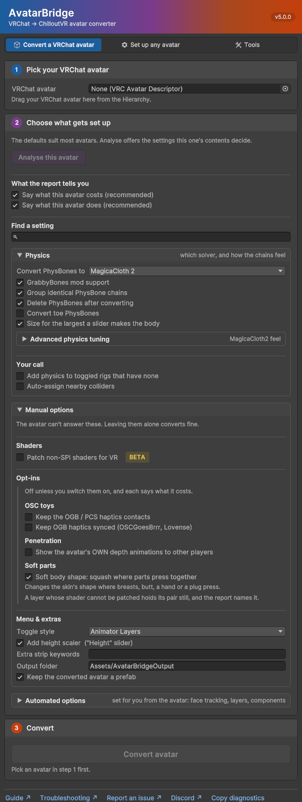

# AvatarBridge: convert your VRChat avatar to ChilloutVR

[](https://github.com/MrTactical/AvatarBridge/releases/latest)
[](LICENSE.md)

A Unity Editor tool that converts a **VRChat SDK3 avatar** into a **ChilloutVR CCK 4 avatar**:
animator, menus, physics, contacts and face tracking. You get a working avatar and a report of what to check.

https://github.com/user-attachments/assets/8785ecd8-bd2f-407c-802f-fd233cf777c9

**Contents**

- **Start here:** [What to expect](#what-to-expect) · [Requirements](#requirements) · [Installation](#installation) · [Usage](#usage) · [Highlights](#highlights)
- **What it does:** [What gets converted](#what-gets-converted) · [Physics](#physics-physbones-to-magicacloth2-or-dynamicbone) · [Contacts](#contacts) · [Constraints](#constraints-that-drive-another-object) · [Shaders](#shaders-that-only-draw-into-one-eye) · [Parameter types](#parameter-types) · [Face tracking](#face-tracking)
- **Tools:** [Avatar Tester](#avatar-tester) · [ChilloutVR Toolkit](#chilloutvr-toolkit) · [Setup mode](#setup-mode) · [Store description](#store-description)
- **YAPS (18+):** [YAPS: penetration that works in ChilloutVR](#yaps-penetration-that-works-in-chilloutvr)
- **Reference:** [Options reference](#options-reference) · [Known limitations](#known-limitations) · [Troubleshooting](#troubleshooting) · [vrc3cvr comparison](#already-using-vrc3cvr)
- [Reporting a bug](#reporting-a-bug) · [Credits](#credits) · [License](#license)

## What to expect

AvatarBridge does most of the work, not all of it. The two platforms differ, and no two VRCFury
setups are alike.

- **You need basic Unity:** the Animator window, blend trees, the `CVRAvatar` component.
- **Read the report.** Every conversion writes one. Act on each *Warning*, *Approximated* and
  *Skipped* entry.
- **Test in ChilloutVR before you call it done.** Physics, shaders and sync can only be judged in
  game. The editor can show that an avatar converts, never that it behaves.

150+ avatars have been converted, uploaded and worn in ChilloutVR, by the author and by independent
testers. Confirmed in game:

- contacts fired by other players' hands, with the reaction, sound and particles seen by the room
- menu toggles and sliders whose effects other players see
- stereo shaders drawing in both eyes
- prefab constraints driving real bones

Bugs still turn up. [Report one](#reporting-a-bug) and it gets fixed.

## Requirements

| What | Version | Notes |
|---|---|---|
| [Creator Companion](https://vcc.docs.vrchat.com/) (or [ALCOM](https://vrc-get.anatawa12.com/en/alcom/)) | current | makes the project itself; see [Installation](#installation) |
| Unity | **2022.3.22f1** | the version VRChat and CCK 4 both use; install it through VCC |
| ChilloutVR CCK | **4.0.x** | always required |
| VRChat Avatars SDK | SDK3, **via VCC / VPM** | needed to convert. Without it you get [Setup mode](#setup-mode). The legacy `.unitypackage` SDK cannot coexist with the CCK; see [Troubleshooting](#troubleshooting) |
| [VRCFury](https://vrcfury.com/download) / [Modular Avatar](https://modular-avatar.nadena.dev/) | current | only if your avatars use them |
| [MagicaCloth2](https://assetstore.unity.com/packages/tools/physics/magica-cloth-2-242307) | optional | recommended physics target |
| [DynamicBone](https://assetstore.unity.com/packages/tools/animation/dynamic-bone-16743) | optional | alternative; the free [VRLabs stub](https://github.com/VRLabs/Dynamic-Bones-Stub) is enough to convert |
| YAPS add-on (18+) | optional | penetration. Needs only Unity and the CCK; see [The YAPS add-on (18+)](#the-yaps-add-on-18) |

Neither physics package is required. Set **Convert PhysBones to** to **None** and everything else
still converts.

## Installation

### The converter and the Toolkit

**Already build avatars? Duplicate that project and start at step 3.** It has the SDK, VRCFury or
Modular Avatar and your avatars, imported in the right order.

1. **A VCC project on Unity 2022.3.22f1.** Duplicate your avatar project, or **New Project →
   Avatars**. Never convert in your real upload project.
2. **VRCFury / Modular Avatar, then your avatars.** Add the packages in VCC's **Manage Packages**.
   VRCFury goes in before the avatars that need it.
3. **ChilloutVR CCK 4.** The `.unitypackage` from
   [the ChilloutVR documentation](https://docs.chilloutvr.net/cck/setup/). Import it into `Assets`.
4. **A physics package** (optional): MagicaCloth2 or DynamicBone.
5. **AvatarBridge, last.** `AvatarBridge-<version>-public.unitypackage` from
   [Releases](https://github.com/MrTactical/AvatarBridge/releases). It must sit under `Assets`, not
   `Packages`, or the MagicaCloth2 and DynamicBone support will not load.

> **Note.** The VRChat SDK ships only as a VPM package, and VPM packages install only into projects
> that VCC or ALCOM manage. A Unity project made by hand cannot get one. Import in the order above
> and let Unity finish compiling after each step: out of order can corrupt VRCFury data or leave
> broken scripting defines. One extra recompile after importing AvatarBridge is normal.

### The YAPS add-on (18+)

Penetration is a separate adults-only download: `YAPS-<version>-adult.unitypackage`, on the same
[Releases](https://github.com/MrTactical/AvatarBridge/releases) page.

- **With the converter:** import it after AvatarBridge. A converted avatar then keeps its
  penetration. Without it, penetration is removed; the report says so, and **Get the YAPS add-on
  (GitHub)** under **Automated options** links to the download.
- **On its own:** it needs no VRChat SDK and no converter. Unity 2022.3.22f1, ChilloutVR CCK 4,
  then the package under `Assets`.

Both packages install to `Assets/AvatarBridge`, so either order works and nothing is duplicated.
What it does and how to use it: [YAPS](#yaps-penetration-that-works-in-chilloutvr).

### Updating

1. Move any chain preset you saved in `Assets/AvatarBridge/Presets` somewhere else in `Assets`. It
   is found wherever it is.
2. Delete `Assets/AvatarBridge`.
3. Import the new converter package, then the YAPS add-on if you use it.

Your conversions live in `Assets/AvatarBridgeOutput`, which updates never touch. Unity never
removes old files on import, which is why the delete matters, most of all coming from 4.4.x or
older.

## Usage

Open **Tools ▸ Avatar Bridge ▸ VRChat to ChilloutVR Converter** and stay on the **Convert a VRChat
avatar** tab. The window has three numbered cards.

<p align="center">
  
</p>

1. **Pick your VRChat avatar.** Choose the avatar in your scene.
2. **Choose what gets set up.** The defaults suit most avatars.
   - Press **Analyse this avatar**. It reads the avatar and offers the settings its contents
     decide, such as the physics target, the face tracking mode and which layers to merge. Nothing
     changes until you apply it.
   - Each recommendation has its own **Apply**. With two or more, **Apply all N recommendations**
     takes the measured ones. *Your call* rows are never applied for you.
   - Under the results, **What the report tells you** has two read-only ticks, both on by default:
     **Say what this avatar costs (recommended)** and **Say what this avatar does (recommended)**.
   - **Physics** and **Manual options** are open: which solver to convert into, and the few things
     the avatar cannot tell you. **Automated options** is folded because Analyse sets it. The
     **Find a setting** box searches all three.
3. **Convert.** Output lands in `Assets/AvatarBridgeOutput/<avatar>/`.

Then read the report and test in ChilloutVR. Every setting is listed in the
[Options reference](#options-reference); you rarely need it.

### What you get

In the output folder:

- **`ConversionReport.md`**: what was done, approximated and skipped. Read it.
- **`ConversionReport.html`**: the same report as a web page with charts and filters. **Open web
  report** in the window opens it. It is one file, so it can be shared as it is.
- **`Diagnostics.md`**: technical detail. Ignore it unless something is wrong, and attach it to
  any bug report.
- **The converted avatar**, as a prefab and in your scene.
- **`RehomedAssets`**: a copy of every clip and mask the controller uses. The folder is the whole
  conversion and can be moved to another project that has the CCK.

In the window, after converting:

- A chip per status (**done**, **approximated**, **skipped**, **warnings**, **errors**) filters
  the results to those rows.
- **Show** on a row selects the object it names.
- **Make it lighter: N MB to reclaim** appears when textures can shrink with nothing visible
  changing. It opens the **Tools** tab on the converted avatar.

If another avatar with the same name already owns the folder, the output goes to `<avatar> 2/`,
`<avatar> 3/` and so on, and the report says so.

### Converting again

Converting the same avatar again tells you what changed. `ConversionReport.md` lists it under
*Since the last conversion*: the settings you changed, a new AvatarBridge version, and every report
line, layer, parameter, menu entry and component count that moved.

- The comparison is kept in the output folder as `.last-conversion.txt`. Delete it to start over.
- **The upload ID is kept.** Once a conversion has been uploaded, converting again uploads over
  the same avatar. See
  [Each upload adds a new avatar](#each-upload-adds-a-new-avatar-instead-of-updating-the-old-one)
  if it does not.

## Highlights

- **It picks the settings from your avatar.** [Analyse this avatar](#analyse-this-avatar) measures what is there and offers each setting.
- **VRCFury and Modular Avatar avatars work.** They are baked first, so toggles, linked clothing and merged armatures survive. See [What gets converted](#what-gets-converted).
- **PhysBones become real physics**, MagicaCloth2 or DynamicBone, sized from your mesh. See [Physics](#physics-physbones-to-magicacloth2-or-dynamicbone).
- **Toggles go both ways.** The "off" direction is real animation. See [A toggle switches on but never back off](#a-toggle-switches-on-but-never-back-off).
- **Contacts a stranger can set off.** Tags are widened so every ChilloutVR player's hands fire them. See [Contacts](#contacts).
- **What your menu does, everyone sees.** Menu-driven parameters always sync. See [Parameter types](#parameter-types).
- **Your own locomotion, emotes and flight pose cross over**, and prefabs that drive your bones through [constraints](#constraints-that-drive-another-object) keep working.
- **Face tracking, three ways.** See [Face tracking](#face-tracking).
- **Penetration converts** with the 18+ add-on. See [YAPS](#yaps-penetration-that-works-in-chilloutvr).
- **Shaders that draw in one eye can be patched.** See [Shaders that only draw into one eye](#shaders-that-only-draw-into-one-eye).
- **A play-mode tester** that drives the converted avatar the way the game does, including a copy as other players see it. See [Avatar Tester](#avatar-tester).
- **A Toolkit for any ChilloutVR avatar:** the converter's checks and fixes as separate cards. See [ChilloutVR Toolkit](#chilloutvr-toolkit).

No VRChat SDK installed? The tool still runs in [Setup mode](#setup-mode).

## Already using vrc3cvr?

AvatarBridge started by studying vrc3cvr (see [Credits](#credits)). Compare against
[Narazaka's vrc3cvr](https://github.com/Narazaka/vrc3cvr) (MIT), the maintained CCK 4 fork; the
[original](https://github.com/imagitama/vrc3cvr) was archived in May 2023. If you want a smaller,
focused converter, it is a good tool.

| | AvatarBridge | vrc3cvr (Narazaka) |
|---|---|---|
| Menus, parameters, gestures | Yes | Yes |
| Settings picked from your avatar | Yes, [Analyse](#analyse-this-avatar) | - |
| PhysBones to DynamicBone | Built in | External tool |
| PhysBones to MagicaCloth2 | Yes | - |
| Modular Avatar | Baked automatically | Own component, manual bake |
| VRCFury | Baked automatically | Manual |
| Contacts | Pointers and triggers, [tags widened](#being-touched-by-ordinary-chilloutvr-players) | Pointers and triggers |
| Penetration (DPS / TPS / SPS) | [YAPS](#yaps-penetration-that-works-in-chilloutvr), 18+ add-on | - |
| One-eye shaders patched | Yes, opt-in | - |
| Constraints that drive another object | Yes | - |
| Custom locomotion, sit and flight | Yes | - |
| Report, upload check, reconvert diff | Yes | - |
| Avatar cost and dead-feature report | Yes | - |
| Play-mode tester | Yes | - |

The right-hand column is read from vrc3cvr's documentation and source as of mid-2026, not from
testing it. If anything there is wrong or has changed,
[open an issue](https://github.com/MrTactical/AvatarBridge/issues) and it gets corrected.

## What gets converted

Anything VRCFury or Modular Avatar installs is baked first, so most prefabs convert unaided.
Confirmed in game: [Avatar Limb Scaling](https://github.com/xNanochip/VRC-Avatar-Limb-Scaling). If
a prefab's control appears and does nothing, [report it](#reporting-a-bug).

**Avatar and menu**

| VRChat | ChilloutVR | Notes |
|---|---|---|
| Avatar descriptor | `CVRAvatar` | visemes, blink, eye look with gaze limits measured from the poses. The viewpoint the author placed is copied; voice goes at the jaw. See [viewpoint and voice](#the-viewpoint-or-voice-position-is-nowhere-near-the-head) |
| Expression parameters and menus | Advanced Avatar Settings | named after the menu control's label; a dropdown's unset value is **None** |
| Menu **Button** controls | ordinary toggles | ChilloutVR has no momentary control |
| Parameter types | real `bool` / `int` / `float` | see [Parameter types](#parameter-types) |
| VRChat's scale parameters | `AvatarHeight` stream and derived values | `EyeHeightAsMeters` is added if missing, and then syncs (32 bits) |
| VRC Head Chop | `FPRExclusion` | show and hide only |
| Jaw-flap lip sync | `visemeMode` `JawBone` or `SingleBlendshape` | no wiring needed |
| Face-tracking blendshapes | native component, bundled rig, or your own rig | see [Face tracking](#face-tracking) |

**Animator**

| VRChat | ChilloutVR | Notes |
|---|---|---|
| Gestures | float threshold bands, as the CCK does it | analog fist blends in by the grip or the trigger, whichever the controller closes a fist with (not yet confirmed in game) |
| Clothing and prop toggles | one `Toggle <name>` layer each | "off" is [real animation](#a-toggle-switches-on-but-never-back-off), not Write Defaults |
| Animation clips and masks | copied into `RehomedAssets` | the output folder is the whole conversion |
| Weight-gated reaction layers (`VRCAnimatorLayerControl`) | rebuilt at full weight | ChilloutVR cannot change a layer's weight, so headpat and boop reactions are rebuilt to play |
| Base, Action and Sitting locomotion clips | grafted into ChilloutVR's `Locomotion/Emotes` layer | custom walk, crouch, crawl, fall and sit; Base and Action only while ticked under *Animator layers to convert* |
| Flight and copter systems | pose grafted onto `LocFlying` | ChilloutVR flies natively; your pose plays when you fly |
| VRC tracking and locomotion control | `BodyControl` | head, pelvis, arms, legs and locomotion map exactly; eyes, mouth and fingers have no mask. See [emote hand poses](#an-emotes-hand-pose-is-wrong-or-follows-your-gesture) |
| Animation writing material properties the shader lacks | removed | **Remove animation that can't do anything (recommended)**, on by default; the source is untouched. See [Troubleshooting](#a-toggle-switches-on-the-layer-plays-and-nothing-changes-on-screen) |

**Physics and contacts**

| VRChat | ChilloutVR | Notes |
|---|---|---|
| PhysBones and colliders | MagicaCloth2 or DynamicBone | see [Physics](#physics-physbones-to-magicacloth2-or-dynamicbone) |
| PhysBone `_IsGrabbed` / `_Angle` | [GrabbyBones](https://github.com/kafeijao/Kafe_CVR_Mods/tree/master/GrabbyBones) mod | optional client mod, not bundled; see [Grabbing a chain](#grabbing-a-chain) |
| Contacts | `CVRPointer` and trigger | see [Contacts](#contacts) |
| VRC Constraints | Unity constraints | *Target Transform* included; see [Constraints](#constraints-that-drive-another-object) |
| DPS / TPS / SPS penetration | YAPS, with the 18+ add-on | removed without the add-on; see below |
| FinalIK components | kept as they are | ChilloutVR deletes some; see [quadrupeds](#quadruped--finalik-avatars) |

**Rig, mesh and material fixes**

| What | Result | Notes |
|---|---|---|
| A humanoid **Jaw** mapped to something that is not a jaw | rig rebuilt without it | stops the voice coming out of that object; reported |
| An armature moved or scaled after the rig was made | rig rebuilt to match | stops the avatar floating or sinking in game; reported |
| Skinned mesh bounds | resized to the avatar's volume, plus 0.3 × eye height of clearance (at least 0.45 m) | stops meshes vanishing at screen edges |
| Shaders without stereo support | patched copy in `RehomedAssets` | optional; see [Shaders](#shaders-that-only-draw-into-one-eye) |
| VRCFury temp materials and shaders | rescued into `RehomedAssets` | VRCFury deletes its temp folder on its next build |

**Audio**

| VRChat | ChilloutVR | Notes |
|---|---|---|
| Avatar audio sources | clamped to VRChat's limits and made fully 3D | a 2D source can be silent for everyone but you; see [Troubleshooting](#a-sound-or-particle-effect-only-you-can-see-or-hear) |
| Animator-played audio (`VRCAnimatorPlayAudio`) | loops follow their state; one-shots play to the end | one clip at a fixed volume and pitch; random choice, ranges and delays are listed in the report |

**Removed**

| What | Notes |
|---|---|
| GoGo Loco | by default; see [GoGo Loco](#gogo-loco) |
| OGB, PCS and Wholesome haptics contacts | by default; see the penetration paragraph below |
| VRCFury Parameter Compressor | it marks real parameters not synced, so carried across the values reach nobody. Removing it puts them back to syncing natively |
| Screen cameras and audio listeners | ChilloutVR deletes screen cameras on load, and a listener takes over your ears. A camera drawing into a RenderTexture is kept |

**Penetration.** With the [YAPS add-on](#yaps-penetration-that-works-in-chilloutvr) installed, DPS,
TPS and SPS convert to YAPS: the **Penetration** choice under **Automated options** defaults to
**Convert to YAPS (recommended)**. The other two answers are **Remove**, which takes it all out,
and **Leave as VRChat built it**, which touches nothing. Without the add-on the choice is not shown
and penetration is removed. The OGB, PCS and Wholesome haptics contacts are removed either way,
because each one spends the instance's shared contact budget. To drive a toy from them, tick
**Keep the OGB / PCS haptics contacts** (**Manual options ▸ Opt-ins ▸ OSC toys**); it acts only
while **Penetration** is **Convert to YAPS (recommended)**.

<details>
<summary>More on these rows</summary>

- **Menu Button controls.** A button driving two states that hand over on the same condition would
  loop while switched on, so the way back is set to the opposite condition. If a contact drives the
  same control, the touch holds it on instead of tapping it.
- **Reaction layers.** VRChat holds these at weight 0 and raises them when a contact or control
  fires. Rebuilt, fade durations become instant, and properties shared with other layers are left
  to them. A layer that rests inside its own reaction cannot be rebuilt: it stays at weight 0 and
  the report warns.
- **Locomotion clips.** Matched by blend-tree position, with loop settings matched to the slot.
  VRChat's `proxy_*` placeholders are skipped; ChilloutVR's own animation set is their equivalent.
  Analyse recommends **Base / locomotion** when the avatar has its own.
- **Scale parameters.** `EyeHeightAsMeters` is fed live. `ScaleFactor`, `ScaleFactorInverse`,
  `EyeHeightAsPercent` and `ScaleModified` are computed from it against the converted viewpoint
  height.
- **Jaw.** Unity's Auto-Map can assign a Jaw to whatever is nearest. ChilloutVR takes that bone
  literally for the voice position and jaw visemes. With no Jaw, voice falls back to a measured
  mouth and visemes stay on blendshapes. An avatar using jaw-flap lip sync keeps the Jaw its
  VRChat descriptor moves.
- **Moved armature.** The rig records where the hips were, and a running animator places them from
  that record. Only the objects above the hips and the hips' position are rewritten; the limbs keep
  the rig's T-pose. The source avatar is untouched.
- **Mesh bounds.** Measured from the bones that skin the avatar. Boxes that were bigger are brought
  down too.
- **Audio sources.** Doppler 0, distance floors and caps. ChilloutVR feeds sources to its
  spatializer unclamped, and one source with `minDistance 0` on the body can mute the game's audio
  while worn.
- **Animator-played audio.** A loop plays for as long as its state plays, by animating the
  AudioSource. A one-shot is a `CVRAudioDriver` pulse. One-shot states sharing an AudioSource each
  keep their own clip. Two looping states on one source both play the first one's clip, and the
  report names them. A one-shot with no clip is listed as removed.
- **Cameras.** A kept RenderTexture camera has its depth clamped to ChilloutVR's range.

</details>

### GoGo Loco

- **Removed by default** (**Remove GoGo Loco (recommended)**, under **Automated options**).
  ChilloutVR has its own locomotion, emotes, AFK and flight, and GoGo's layers fight them while
  spending about 15 synced parameters. GoGo installed through a VRCFury prefab is removed too.
- **Its poses go to the emote wheel** (**Put GoGo poses in the emote wheel**, on by default,
  offered while GoGo is removed). Up to eight: the avatar's own GoGo emotes first, then GoGo's sit
  and lie poses, each named. They replace ChilloutVR's stock emotes on that avatar and cost no
  sync. A pose or looping emote holds until you move; a one-shot plays once. While one plays,
  ChilloutVR mutes your hand gestures, as it does for every emote.
- **Not carried:** GoGo's height, puppet and pose controls. A floor pose keeps a standing
  viewpoint, because ChilloutVR cannot lower the camera with the body.

<details>
<summary>Keeping GoGo (experimental)</summary>

Untick **Remove GoGo Loco (recommended)** and GoGo replaces ChilloutVR's locomotion: the CCK's
`Locomotion/Emotes` layer is removed and GoGo's own layers take over. **Base, Additive and Action
must be ticked** under *Animator layers to convert*, or the avatar has no locomotion at all.

The limits come from VRChat-only features with no ChilloutVR equivalent. They are not bugs to
report:

- Poses do not lock movement, so a pose slides if you walk.
- Floor poses keep a standing viewpoint.
- ChilloutVR's quick-menu emotes stop, because GoGo's wheel replaces them.

Removing GoGo stays the recommended path.

</details>

### How animator layers are ordered

ChilloutVR runs one animator controller where VRChat runs several, so the conversion stacks every
layer into one. Where two layers animate the same thing, the higher one wins.

<details>
<summary>The order, and why merged layers are kept off the body</summary>

**The order, bottom to top**

1. ChilloutVR's own layers: locomotion and emotes, then the hand layers unless your gesture layer
   takes their place.
2. Your VRChat controllers in descriptor order, each keeping its own layer order and named `[FX]`,
   `[Gesture]` and so on.
3. Toggles split out of a shared layer.
4. A toggle lifted out of a blend tree, directly above the layer it came from.
5. Layers the conversion adds, such as height scaling and face tracking.
6. If you press the CCK's **Create Controller**, its layer for each menu entry that switches
   objects itself goes above all of these and wins.

`Diagnostics.md` lists the finished stack with each layer's weight, blending and mask.

**Why merged layers are kept off the body**

In VRChat the FX layer cannot move the body at all, so body curves left in it never showed. In one
animator they would. A merged layer left free to write the body fights locomotion: the avatar holds
one pose, drops into a bent rest pose, or rests a hand in a fist. So:

- **FX layers are masked off the humanoid rig, always**, as VRChat treats them. Toggles and
  blendshapes in them still work. The report lists the ones that posed the body under *FX layers
  kept off the body, as in VRChat*.
- **Layers merged from VRChat's Base are masked too**, and named. Above ChilloutVR's locomotion
  they could only replace it.
- **Fingers are masked off any layer above the hand-pose layers** that would write them, and each
  is named.
- **Other layers that animate the body on purpose are left alone**, with a warning.

A masked layer applies only the first slot of a material swap; see
[A material swap changes only some parts](#a-material-swap-changes-only-some-parts).

**Finding a layer that overrides another**

With **Say what this avatar does (recommended)** on, the report names layers a layer above always
hides, states that can never play, states that put the body in the bicycle pose, and things more
than one layer animates. It also lists every parameter with its type, sync, default, readers and
writers, and the name it had before conversion. The Toolkit's **What this avatar does** card gives
the same survey for any avatar; see [ChilloutVR Toolkit](#chilloutvr-toolkit).

</details>

## Physics: PhysBones to MagicaCloth2 or DynamicBone

- **What transfers:** the bone a chain hangs from, its colliders, the transforms it leaves out,
  whether it started enabled, and squish.
- **Soft bodies:** on MagicaCloth2, a breast, butt, belly or thigh becomes a soft body held near
  its rest position, not a hanging chain.
- **Sizes are measured from your mesh**, with your blendshape sliders applied, so people touch
  what they can see.
- **The feel is derived from the PhysBone:** pull, spring, stiffness, gravity and immobile are
  converted, and the report gives the numbers. The maths is in
  [docs/SolverCalibration.md](docs/SolverCalibration.md).
- **What cannot cross:** *inside bounds* colliders, stretch over 3%, *Multi Child Type: First*,
  and grabbing (see [Grabbing a chain](#grabbing-a-chain)). The report names each.
- **Using DynamicBone?** It is the same kind of simulation as a PhysBone, so it maps almost field
  for field. Details below.

> **Physics can only be judged in game.** The numbers are derived from both solvers; only
> ChilloutVR can judge the result. The [Avatar Tester](#avatar-tester)'s **Interaction lab** card
> is the closest preview. Dragging the avatar around by hand proves nothing.

Every physics setting, in window order:
[Physics: which solver, and how the chains feel](#physics-which-solver-and-how-the-chains-feel).

Already on ChilloutVR with the PhysBones still on? The Toolkit's **PhysBones to cloth** card runs
this conversion in place; see [ChilloutVR Toolkit](#chilloutvr-toolkit).

### Toggled physics

Hair swaps and outfit toggles that switched a PhysBone in VRChat switch the converted physics too,
on and off.

- **Colliders follow.** A dress that turns off the leg colliders it would clip switches the
  converted collider's object.
- **Off stays off.** A collider disabled in VRChat converts switched off. One under a switched-off
  object is off at load and comes on with that object, a *CVR Native Targets* toggle included.
  Contacts do the same.
- **One case keeps simulating on purpose:** a hidden style whose bones still carry a visible mesh
  from outside it, such as add-on hair on a base hairstyle's rig. Stopping it would leave the
  visible hair rigid. The report names each.
- **If a chain was not converted, its toggle has nothing to switch.** The report warns for each,
  naming the clip and the PhysBone, beside the *Skipped* entry that says why.

What does not carry over is listed under [Converted with caveats](#converted-with-caveats).

### Grabbing a chain

**Converted physics has no grab.** In VRChat you can take hold of a PhysBone and pull it. Converted,
those chains hang and swing, but nobody can hold them.

- **[GrabbyBones](https://github.com/kafeijao/Kafe_CVR_Mods/tree/master/GrabbyBones) adds grabbing
  back.** With **GrabbyBones mod support** on (the default), converted physics objects are named
  after the PhysBone's parameter, so the mod's `_IsGrabbed` and `_Angle` drive your existing logic,
  and those parameters stay synced. It is a client mod: only people who installed it can grab.
- **A feature built on pulling a chain goes inert without the mod.** Everything looks wired, and
  nothing fires. The report lists every chain that was grabbable in VRChat and marks the ones
  carrying a contact.
- **Pushing needs no mod.** ChilloutVR gives every avatar a MagicaCloth2 collider on each hand,
  and those hands push other people's converted cloth (between friends by default, in ChilloutVR's
  settings). A converted collider on a hand or finger is written as a sphere, because a capsule
  there stops ChilloutVR adding the hand's own collider.

### Where the converted physics lives

Every cloth sits on its own object under one **MagicaCloth Phys** object on the avatar root
(**DynamicBone Phys** on that path). A cloth belonging to a toggled outfit is switched off by the
toggle's own animation.

- **Names.** Each object is named after the bone its chain hangs from, such as `MagicaCloth_Tail`.
  A grouped cloth is named after the parent its chains share. With **GrabbyBones mod support** on,
  a PhysBone that has a parameter names its object after the parameter.
- **Numbers.** Two chains on bones with the same name give `MagicaCloth_Tail` and
  `MagicaCloth_Tail 2`. The number counts chains, not conversions: four outfits with an ear chain
  each give four numbered objects in one conversion.
- **Several PhysBones on one bone** give one object each. Only one is left driving the chain, and
  the report says which.

### Physics in detail

<details>
<summary>Soft bodies: breasts, butts, bellies and thighs</summary>

Chains read as a breast, butt, belly or thigh are written as MagicaCloth2's **Bone Spring**: a
volume anchored to a bone and held near rest. Bone Cloth is for things that hang.

- Collision is offered on one bone per side: the one whose pivot sits nearest the middle of the
  mesh that side carries, at the size of that mesh.
- Inertia is left at the preset's value and not converted from *Immobile*. An anchored body cannot
  be thrown off the avatar.
- The root is held still; the jiggle stays in the tip.
- A piercing or charm hanging from a breast bone is converted as jewellery, not as a second soft
  body.

</details>

<details>
<summary>Add-ons that build physics out of constraints</summary>

Add-ons that stack helper chains and drive the real bone through constraints cannot cross: a cloth
simulates each chain alone. The report names the add-on, removes its helper rig, and puts one soft
body on the bone it was driving.

- The stand-in's root may slide about the body's own length, and it collides at that root.
- Its bending is held near rest and capped at 10 degrees on a softer spring, so a press pushes it
  aside more than it bends it.
- Most of the avatar's own movement is kept out of it.

The stand-in is one soft body where the add-on had several chains, so it will not feel identical.
**Not yet confirmed in game.**

</details>

<details>
<summary>Size and body sliders</summary>

Every radius comes from the mesh with your blendshape weights applied, so a body slider saved
part-way up is measured as you wear it.

- A size slider that **scales bones** is followed for free, because the cloth simulates those
  bones.
- A slider that works by **blendshape** moves no bones, and MagicaCloth2 cannot animate a radius.
  So the mesh is measured a second time with every animated blendshape pushed as far as the
  animator can take it, and the larger reading wins. Collision is a little generous with the slider
  down and never inside the body with it up.
- Shapes that shrink cost nothing.

The report names every chain sized this way, and every chain whose slider it could not follow.
Settings: **Size particles from the mesh** and **Size for the largest a slider makes the body**.

</details>

<details>
<summary>Colliders fitted to the body</summary>

A PhysBone collider has one radius. MagicaCloth2's capsule takes a start and an end radius, so a
converted thigh or arm collider tapers the way the limb does.

- The body part the collider sits on is measured, and the capsule is fitted to it. The measurement
  replaces the source's numbers, which are often one default stamped on every collider.
- Only the host bone's own vertices are read, so a leg collider can only come out leg-sized.
- Chains collide with whole bones against their colliders, as in VRChat, not only at the joints.

Every change is in the report with its before and after. **Fit colliders to the mesh** turns it
off.

</details>

<details>
<summary>What "Fit the preset to the PhysBone" changes</summary>

Each chain's pull, spring and stiffness become MagicaCloth2's damping and angle restoration along
its whole length, so a curve that loosens a chain in the middle comes across too. Gravity is
converted so the chain settles where VRChat settles it. **Fit the preset to the PhysBone** then
applies these facts about the source:

- **No gravity** stays none. A preset's own gravity would make a chain fall for the first time in
  ChilloutVR.
- **Negative gravity** points up.
- **Immobile** becomes inertia, against the same thing VRChat measures it against: an inertia
  anchor on the chain's parent bone for *All Motion*, world inertia for *World*.
- **Wind influence goes to zero.** VRChat has no wind; ChilloutVR worlds do.
- **The preset's own angle limit and depth inertia go off.** The source's angle limit, if it had
  one, becomes the swing bound.
- **Speed limits are raised** from the preset's (1 m/s on the springs) to MagicaCloth2's defaults.
  A limit is kept so a teleport cannot fling the chain. Each raise is reported.
- **A radius curve** tapers the particles along the chain as it tapered the PhysBone's radius.

**`Is Animated` sets Animation Pose Ratio to 1**, with that option on or off. Without it a slider
that scales a chain's own bones stops working. The report names each chain.

A cloth also records the size the avatar was converted at, so a chain hangs the same on a small or
a large avatar.

</details>

<details>
<summary>Squish, stretch, left-out bones and multi-child chains</summary>

- **Squish** carries over as how firmly a chain's bones hold their length.
- **Stretch** cannot: MagicaCloth2 lets no chain stretch more than 3%. *Max Stretch* is reported.
- **Multi Child Type** *Ignore* (the default) roots the cloth at each branch's first bone, so a
  skirt or a bunch of hair strands moves from where VRChat moves it. A soft body stays rooted at
  the branching bone. *Average* turns the root toward its branches but cannot carry them rigidly.
  *First* has no equivalent.
- **Angle limits** become a distance bound while **Bound swing to the source's limit** is on, as
  it is by default.
- **Left-out transforms** are usually kept out by starting the cloth below them. Where that leaves
  too little chain, the cloth starts at the chain's root and marks those bones to be left alone.
- **A PhysBone nested inside another's chain** is left to its own cloth, as VRChat does: the outer
  cloth marks those bones to be left alone. DynamicBone excludes it exactly.
- **An *inside bounds* collider** has no equivalent. The report names it.

</details>

<details>
<summary>The DynamicBone path</summary>

PhysBones and DynamicBone are the same kind of simulation, so this path maps field for field, with
three rescalings ([the derivation](docs/SolverCalibration.md)):

- pull becomes elasticity at 0.2×
- gravity becomes a force at the same 0.2×, so the resting pose matches VRChat's
- spring becomes damping, inverted

Do not "fix" either 0.2× back up. Raising elasticity alone makes the chain about five times
stiffer; raising the force alone makes it deflect about five times further.

Two more things:

- **Size for the largest a slider makes the body** still applies: chain radii and converted
  colliders grow by the same mesh measurement. Inside-bound "cage" colliders are left alone.
- **Gravity is written to `m_Force`, never `m_Gravity`.** In ChilloutVR `m_Gravity` goes wrong on
  any avatar not at scale exactly 1, and below 1 it lifts hair and tails upward. ChilloutVR resizes
  every avatar, so it is rarely at scale 1. `m_Force` behaves the same at any size. The
  cost is `gravityFalloff`, which cannot come along; the report names each chain that had one.

</details>

<details>
<summary>Chain grouping</summary>

A PhysBone simulates one root, so twenty-six hair strands are twenty-six components. MagicaCloth2
takes many roots in one component, so chains that would be identical are grouped (**Group identical
PhysBone chains**, MagicaCloth2 only):

- same settings, colliders, parent and kind
- the same bones at the same lengths, each within 5%
- the same mesh thickness where the chain starts, within a quarter

They still swing independently, and the report says what was grouped. A chain with an ignore list,
a PhysBone parameter, a curve on any setting, or a toggle of its own keeps its own component. So
does a breast, butt, belly or thigh.

</details>

## Contacts

VRChat contacts convert onto the CCK's own parts. Each zone keeps its authored shape, sphere or
capsule.

| VRChat | ChilloutVR | Behaviour |
|---|---|---|
| Sender | one `CVRPointer` per collision tag | |
| *OnEnter* receiver | Advanced Avatar Trigger | a pulse on enter |
| *Constant* receiver | Advanced Avatar Trigger | on while touched; resets when any pointer leaves, even if another is still inside. The report notes each |
| *Proximity* receiver | Advanced Avatar Trigger | driven by distance, back to 0 when the sender leaves |

`allowSelf` and `allowOthers` carry over as the trigger's local and network flags.

- **No velocity threshold.** A minimum-velocity setting has no equivalent, so a slow touch fires.
- **A contact reaches other players only through a synced parameter.** ChilloutVR runs an
  avatar's triggers on the wearer's machine alone, so reaction parameters are left synced.
  Penetration depth and haptics parameters are the exception: local by default, with opt-ins in
  the YAPS add-on.

**Zones follow the body's growth sliders** (**Grow contact zones with the body's sliders**, on by
default). A zone on a body that a blendshape slider grows is measured at rest and at full reach.
Where one slider owns the growth, the zone's scale is animated in that slider's own clips. Where
several shapes share it, the zone holds the grown size. The report names each zone and which was
done.

A contact on a chain that had to be grabbed goes inert without GrabbyBones; the report marks
these. See [Grabbing a chain](#grabbing-a-chain).

### Being touched by ordinary ChilloutVR players

A contact fires only when something sends a matching tag, and the two platforms name the same body
parts differently. Every ChilloutVR player carries pointers on their hands and index fingers,
whatever avatar they wear. Converted receivers listen for those names as well:

| Your receiver listens for | Also listens for |
|---|---|
| `Hand` | `grab` |
| `HandL` / `HandR` | `LeftHand` / `RightHand` |
| `Finger`, `FingerL`, `FingerR` or any `FingerIndex*` | `index` |

The VRChat tags are kept, so converted avatars still trigger each other as before.

**Custom tags reach nobody else.** A tag the author invented (any word that is not a body part)
works between two copies of the same avatar and for no one else, because nothing else in the game
sends that word. That is usually deliberate, so nothing is changed, and the report lists them. Add
a hand or finger tag (`Hand`, `HandL` / `HandR`, `FingerIndexL` / `FingerIndexR`) to a receiver if
strangers should set it off.

### Anchors and animated switches

- **Contacts anchor where VRChat anchored them.** A contact with a `Root Transform` override is
  parented at that bone, so it follows the same bone it did in VRChat.
- **A menu toggle that switched a contact off in VRChat switches the converted contact's object.**
- **Curves that moved a contact move it.**
- **Curves on a contact's shape or filters are removed** and named in the report.
- **Where several layers wrote one contact's switch**, the conversion keeps the real toggle and
  removes the rest. A switch-off with no way back gets the restore written in. The report says
  what it settled.

## Constraints that drive another object

A VRC constraint can sit on one object and drive a different one through its *Target Transform*
field. Prefabs use this to drive your real bones from their own hierarchy.

- **Target Transform is honoured.** The Unity constraint is put on the target, with the same
  sources.
- **Several constraints of one type on one object merge into one.** Unity and ChilloutVR allow one
  per type per object. The report names each merge.
- **Animated offsets carry on parent constraints only**, position and rotation, per source. On
  other types the constraint keeps the offset it was built with, and the report lists each curve.
- **Constraints under a mirrored parent land reflected.** Unity has no correction for a parent
  scaled negative on an axis. The report names every one.

A Target Transform that points outside the avatar cannot be honoured; the report says so.

<details>
<summary>How it works</summary>

**Everything is taken from the target.** The rest values and the measured offset describe the bone
being driven, not the object the component sat on.

**A rotation constraint's offset is measured, not copied.** VRC constraints run in the editor, so
the scene pose at conversion time is VRChat's own result, and the offset is derived from it.
Multi-source, part-weighted or inactive constraints still copy the field, as do the other
constraint types. When merging, the second constraint's sources join the first, which keeps its
own offsets and rest values.

**Solving in local space is repaired where it can be.** A VRChat constraint can read the source's
local rotation; Unity's only solve in world space.

- Where object and source share a parent, this costs nothing.
- Where the source sits in a different chain, the constrained bone is moved under the source's own
  parent, which makes the two agree exactly. This is what makes many
  [quadrupeds](#quadruped--finalik-avatars) work.
- A bone is moved only when nothing depends on where it is: rotation-only relay, no mesh skinned
  to it, no animation addressing it, nothing mirrored. Every move is named in the report; anything
  failing a check is left alone and reported.
- A bone that carries bones of its own and hangs from a physics chain is never moved. If its
  source never changes its own rotation, the bone's own parent drives it instead.

**Where it cannot be repaired, the constraint yields to its animation.** If the bone skins the
mesh and cannot be moved, the converted constraint is wrong whenever the two parent chains diverge.
When a clip also poses that bone, the constraint is disabled and the animation stands. Only the
live follow is lost. Bones nothing animates keep the world-space follow.

</details>

## YAPS: penetration that works in ChilloutVR

https://github.com/user-attachments/assets/474b2396-85be-40d2-b5b3-f14aaa7368f1

VRChat has three penetration systems: Raliv's **DPS**, Thry's **TPS** and VRCFury's **SPS**.
**YAPS** (Yet Another Penetration System) is a fourth, written from scratch for ChilloutVR. It ships
no VRChat code and it talks to the other three: a YAPS plug bends into DPS and SPS sockets, and
DPS, TPS and SPS plugs find a YAPS socket.

- **It is a separate download, for adults (18+)**: `YAPS-<version>-adult.unitypackage`, on the same
  releases page as the converter. See [Installation](#installation).
- **Without it, penetration is removed** when you convert. The plug mesh stays, straight, and the
  report says where to get the add-on.
- **With it, there are two ways to use it:**
  - **Converting a VRChat avatar.** The converter rebuilds the avatar's DPS, TPS or SPS as YAPS,
    with the author's tuning carried across.
  - **The YAPS tool**, for any ChilloutVR avatar or prop, VRChat history or not: add sockets, make
    a plug, tune it, preview it in the editor.

Both ways build the same thing with the same shader, so a converted avatar and a hand-built one
work with each other.

### Quick start

**A. Converting a VRChat avatar**

1. Install the add-on.
2. In the converter, leave **Penetration** on **Convert to YAPS (recommended)**.
3. Convert, upload, and test with a second person in ChilloutVR.

**B. An avatar or prop already on ChilloutVR**

1. Open *Tools ▸ Avatar Bridge ▸ YAPS ▸ Setup* and drag the avatar or prop into step 1.
2. In step 2, add what it needs: **Add a hole**, **Add a ring**, or **Make selected mesh a plug**.
   An avatar that already carries DPS, TPS or SPS needs nothing added.
3. In step 3, press **Bake every plug and verify**. Then upload.

The editor preview shows the bend. Contacts, sync and what other people see exist only in
ChilloutVR, so always finish with a test in game. See [Testing it](#testing-it).

### What a conversion does

- **A plug bends into a socket and threads it along its axis.** It eases in as it approaches and
  relaxes when pulled away. A plug made of several meshes (a tip, a ring, a harness) bends as one
  piece.
- **A socket opens around a plug.** A socket with a mesh of its own opens in its shader, at the
  entry and up to fifteen further depths. A socket whose shapes are on the body mesh opens through
  a contact that reads the plug's tip. Either way the depth reactions the author built are kept.
- **Every socket is rebuilt as a native YAPS socket**, with the same code the YAPS tool runs.
  VRCFury's socket menu toggles are wired to the rebuilt sockets, so the menu still means what it
  says. One exception: a socket whose reactions read several depth parameters keeps its original
  triggers and layers, and the report says so.
- **It speaks DPS, TPS and SPS.** Rebuilt sockets carry the contact tags and marker lights those
  systems read, so someone on an avatar built for another system works with yours.
- **The author's tuning carries across.** Curvature, squeeze, idle shrink and the rest are read
  from the DPS, TPS or SPS material. Anything with no counterpart is named in the report.
- **DPS and TPS parts are upgraded in place**, beside an SPS bake or not. Converting again does it
  again, so nothing is lost to a reconvert.
- **Auto socket mode** is carried over from VRCFury. It picks the nearest socket the author ticked
  *Auto* on and stays there, without flickering between neighbours.
- **The result is editable.** Every converted plug and socket carries a **YAPS Plug** or
  **YAPS Socket** component, so [the YAPS tool](#the-yaps-tool) can retune it and bake again.

The OGB and PCS haptics contacts drive toys, not shapes. They are removed unless you tick
**Keep the OGB / PCS haptics contacts**. **Remove** takes all penetration out. The report lists
what was built and what could not be.

**How a plug finds a socket**

| Route | Sync cost | Works when | Good for |
|---|---|---|---|
| **Screen atlas** | One synced parameter per avatar (the owner id) | The viewer has custom shaders on, the view is at least about 240 pixels square, and both avatars share an atlas protocol | Everything: tags, one-way rings, [portals](#portals), your own sockets, several sockets on one path |
| **Marker lights** | None with one lit socket. With two or more, one synced **Marker lights** menu choice | The viewer's client draws the plug and the wearer has lit that socket | DPS content and views too small for the atlas. Position only: no tags, no portals |

- The atlas answers first. Marker lights stand in where the atlas cannot answer.
- A plug bends only toward a socket it can resolve. With nothing in reach it stays as it is.
- A plug sees sockets within about 1.2 of its own lengths.
- **Contacts alone never bend a plug.** A socket that announces itself only by contacts, as older
  TPS orifices do, is not found.
- Every viewer's client works the bend out for itself, so no position is synced and nothing
  arrives late. A viewer with lights or custom shaders filtered off sees a less exact bend, or
  none. Nothing breaks.

**Protocol rule.** Both avatars must be built on versions that share an atlas protocol. If a plug
works for one person and not for another, both rebuild on the current version. Without a shared
protocol, marker lights still bend the plug, but tags, one-way rings, portals and your own sockets
do not work.

**What it costs in sync**

| What | Cost | Who sees it |
|---|---|---|
| The bend itself | 0 bits | Everyone |
| Owner id (which sockets are your own) | 32 bits, once per avatar | n/a |
| **Marker lights** menu choice | One synced choice, only with two or more lit-capable sockets | n/a |
| A plug's tag dropdown | One synced choice, only on a plug listing two or more tags | n/a |
| **YAPS readout** toggle | One synced toggle, only while a plug or socket has **In-game readout** ticked | Everyone |
| Converted socket, depth reactions on the body | 0 bits by default | The wearer only |
| The same, with **Show the avatar's OWN depth animations to other players** ticked | 32 bits per socket | Everyone |
| Socket built in the YAPS tool, with body-mesh shapes or depth clips | 32 bits per socket, always | Everyone |
| Socket with a mesh of its own (opens in its shader) | 0 bits | Everyone |

YAPS builds no contact receivers for the bend. Socket toggles and modes stay synced, since those
are yours to set. The opt-in is under *Manual options ▸ Opt-ins ▸ Penetration* and is off by
default: six sockets would spend about 192 of the avatar's 3200 bits. The report's sync budget
says where the avatar landed.

<details>
<summary>How it works under the hood</summary>

**The screen atlas.** Every socket draws its position into a small block of pixels in the corner
of the frame, ahead of the scene. Every plug's shader reads that block from a copy of the screen,
and the block is then put back as it was, so nothing shows. Positions cost no sync bits and no
contact pairs. The full block is 932 by 596 pixels. A smaller view (a small mirror, a low
resolution camera) gets a smaller block with fewer cells, so a crowded instance can lose the odd
socket in that view. Below about 240 pixels square the atlas is off and the plug falls back to
marker lights.

**Reach.** A plug starts turning toward a socket at about 1.6 of its own lengths and is fully bent
by 1.2. Sockets close together are kept apart in the block. Two copies of one prop side by side
can still hide one another.

**Why the protocol matters.** What a socket writes carries a protocol number, and a plug refuses
any other number, in both directions, because the pixels mean different things from one protocol
to the next. Neighbouring versions usually share a number, but not always. Portal exits use rows
of the atlas that sockets never use, so ordinary sockets still cross between 5.0 and the versions
before it on the same protocol.

**The owner id.** Every socket also writes its wearer's owner id into the atlas: a piece of the
ChilloutVR user id, synced as one 32-bit parameter. A plug compares it with its own, so it knows
which sockets are its wearer's at any distance. Until other players' copies have the id, and for
props and world sockets, which carry none, ownership is judged by distance to the nearest hips.
Each socket carries its number on its avatar, 1 to 15. A socket past the fifteenth is judged by
whether it sits on the hips.

**Plugs of several meshes and shared materials.** Every mesh that rides the shaft is baked on the
same frame with the same settings. The body the plug grows from is left as it is and the report
names it. One material carries one plug's bend, so two plugs on different shafts sharing a
material each get a material of their own, on a copy of the mesh, and the report says so. Two
plugs on one mesh each keep their own size sliders, tag chooser and toggles, with sixteen shape
slots between them. A third plug on the mesh shares the second's.

**Two plugs at one socket.** A socket that opens in its shader opens to the deeper of the two.

**Names are left alone.** Parameter names elsewhere on the avatar are not renamed, because
ChilloutVR restores a saved profile by parameter name.

</details>

### The YAPS tool

*Tools ▸ Avatar Bridge ▸ YAPS ▸ Setup.* The window has two tabs: **Set up an avatar or prop** and
**Test it**. Setup is three steps:

1. **Pick your avatar or prop.** Drag it in, or anything under it. The tool takes the avatar or
   prop above what you dropped and lists everything on it.
2. **What it has, and what to add.** One row per plug or socket, with what can read it and what it
   lacks. Add what is missing.
3. **Build.** Press **Bake every plug and verify**. It bakes every plug, builds every socket and
   checks the result. It is safe to run again, and it is the last step before every upload.

**Row buttons (step 2)**

| Button | What it does |
|---|---|
| **Customise** | Opens the plug's or socket's inspector, where its settings and preview are |
| **Remove** | Takes it out completely. A dialog lists what goes |
| **Upgrade to YAPS** | Shown on a DPS, TPS or SPS row. Makes it YAPS on the same mesh |
| **Make editable** | Shown on a converted YAPS row with no component yet. Adds one so you can retune it |

A mesh that another plug carries shows as a *Part of* row. It bends with that plug, on its settings.

**Add buttons (step 2)**

| Button | What it does |
|---|---|
| **Add a hole** | A socket that closes around the plug and stops it |
| **Add a ring** | A socket the plug passes through |
| **Make selected mesh a plug** | Makes the mesh selected in the Hierarchy a plug. With a bone selected it reads **Make a plug from bone** and the bone's name, and uses the skinned mesh from that bone down |

A new socket goes under the bone selected in the Hierarchy, or in a `YAPS/` folder on the avatar.
A line under the buttons says where. Right-clicking a bone in the Hierarchy offers the same two:
*YAPS ▸ Add a hole here* and *Add a ring here*. Point a socket's +Z the way a plug should enter.

**After Build**, *What Build did* lists the result, and **Show me the files** selects
`Assets/YAPS/Generated/<avatar>`. Patched shaders go to `Assets/YAPS/Generated/Shaders`, shared by
every avatar. The first upload after a build compiles each patched shader once, which can take
minutes on an avatar with many materials.

**Tools card** (collapsed, below the steps)

| Button | What it does |
|---|---|
| **Make selected object a prop** | Turns a plug or socket that stands on its own into a spawnable |
| **Verify prop** | Checks a prop before upload and repairs what it can |
| **Quiet the scene view while I work** | Hides CCK icons, pointer spheres, trigger boxes and cloth wires while you place sockets. Editor only. Press again to show them |
| **Clean up leftovers** | Sweeps the avatar for what a hand-deleted plug or socket left behind: empty layers, unread parameters, menu entries aiming at nothing |

**Upgrading DPS, TPS or SPS without the converter.** Press **Upgrade to YAPS** on a row, or just
**Bake every plug and verify**. Sockets gain the markers every plug family reads. Plugs keep
their shader and their author's values. Only a plug on Raliv's own DPS shader moves to *YAPS
Simple Lit*. Check the plug's **Root Bone** on a skinned mesh first. TPS upgrades are confirmed in
game, on props and avatars.

**Edited a material in Poiyomi?** *Tools ▸ Avatar Bridge ▸ YAPS ▸ Re-apply YAPS to selected
materials* puts the deform back after an unlock, edit and re-lock.

#### Props and prefabs

Three menu items under *Tools ▸ Avatar Bridge ▸ YAPS* write ready-made prefabs to
`Assets/YAPS/Prefabs`. The **Test it** tab has the same three as buttons.

| Menu item | What you get |
|---|---|
| *Create universal socket prefabs* | `YAPS Hole` and `YAPS Ring`. Drag one under a bone and point its +Z the way a plug should enter. Every plug family reads it |
| *Create a plug prop prefab* | `YAPS Plug Prop`, a whole spawnable plug, baked, with its pickup and grab collider. Drop it in a scene and upload it from the CCK as a prop |
| *Create a ring-and-socket prop prefab* | `YAPS Ring and Socket Prop`, a spawnable with a ring above and a hole below. Resize the body and move the sockets before uploading. Status: built, not yet confirmed in game |

- **Make selected object a prop**: select the top object of your own plug or socket and press it.
  It adds a CVR Spawnable, a pickup anyone can take and a grab collider. The collider is a
  trigger, so the prop passes through people. It refuses an avatar or anything inside one. Run it
  again after a re-bake. It keeps a collider already on the object, so delete that first if the
  plug changed size.
- **Verify prop** before each upload.
- **Drop the contact channel** appears only on a prop an old build gave one. Press it, or make the
  prop again.
- A prop with two lit sockets shows an old DPS toy one of them at a time. Anything reading the
  screen atlas finds both.

#### After updating

1. Run *Tools ▸ Avatar Bridge ▸ YAPS ▸ Update every YAPS shader in this project*. Building an
   avatar updates its shaders, but nothing builds a prop, so a prop keeps the shader it was made
   with. This walks every material in the project.
2. Upload your props again. The copy on the platform is the one it went up with.
3. Optional: *Remove unused patched shaders*. Each update names its patched shaders afresh, so the
   last version's set stays in `Assets/YAPS/Generated/Shaders`. This moves every shader no material
   or scene uses to the trash, and asks first. It then offers the unused locked Poiyomi copies in
   `Assets/YAPS/Generated/Locked`.

**Made before 5.0.0? Rebuild these:**

- A plug: bake it again. It then keeps its reach when the avatar is resized, and gains
  **Toy Mod Length**.
- A socket whose opening is part of the body's skinned mesh: build or convert again, so it opens
  right at any avatar size.
- A socket prop (the ring-and-socket prefab, or a socket made a prop): make it again and re-upload.
  Its grab box was far too big.

**Stale sockets.** A socket's inspector warns when an older version built it. Pick the avatar or
prop in the Setup window and press **Bake every plug and verify**. A socket from before 4.4.0
never warns. Rebuild it anyway: it may not work for its own wearer.

#### Menu toggles and removing things

- **Build adds a menu toggle, off by default**, for any plug or socket the avatar cannot already
  switch. Anything the avatar already toggles is left alone.
- If the avatar still uses the CCK's stock controller, Build tells you to create its own first
  (*CVRAvatar ▸ Advanced Avatar Settings*).
- **Everything is named after what it is and where it is**: `Chest ring`, `Head hole`. A converted
  part takes the author's own name. The menu entry, parameter, layer and Hierarchy object match.
- **To remove**: **Remove** on the row, or **Remove this plug** / **Remove this socket** in the
  inspector. A dialog lists what will go, and it is one undo step.
- Generated files stay in `Assets/YAPS/Generated` for the next bake.
- Deleted something by hand? **Clean up leftovers** fixes what it left.

<details>
<summary>Menu toggle and removal detail</summary>

**Where the toggle is written.** Build writes the layer and parameter into the controller the
avatar uploads, and into your base controller too when the CCK has generated one from it, so the
layer survives the next *Create Controller*. It never writes into the CCK's stock controller,
which every avatar in the project shares. It does not press *Create Controller* for you and does
not replace your override controller. A toggle an earlier build added that turns out to be
unnecessary is removed by the next build. A socket toggle from an older version that defaulted on
is turned off by the next build.

**Renaming.** A socket you named yourself keeps that name and gains the kind. The object is
renamed only while nothing animates it by path. Moving a socket to another bone renames all of it
on the next Build.

**What Remove takes.** The objects the tool made, the animator layer and parameter, the menu
entries (a plug's deform toggle, own-sockets toggle and tag chooser), the size wiring in your
clips, and the bake. The material it replaced goes back in its slot. With other plugs still on the
same mesh, what they share stays.

**What Remove leaves.** A skinned mesh keeps the culling box the bake gave it. A plug on a plain
mesh gets back the mesh it had before the bake. A plain-mesh plug baked or converted before 5.0.0
has no record of the original: put that mesh back in the Mesh Filter by hand, or convert again.

</details>

### Sockets

A socket is a **YAPS Socket** component on an object whose +Z points the way a plug enters.

| Field | Card | What it does |
|---|---|---|
| **Kind** | What it is | *Hole* closes around the plug and stops it. *Ring* lets it pass through |
| **One way** | What it is | Rings only. A plug enters from the front (the side its markers sit on) and passes it by from behind. Screen atlas only: by marker light a plug still enters from either side |
| **Portal exit** | What it is | Holes only. See [Portals](#portals) |
| **Tags** | What it is | Words saying what the socket is. See [Tags](#tags) |
| **Mesh** and its shapes | Opens as a plug goes in | The mesh whose shapes open, and up to sixteen of them, each over its own depth range. Several can share a depth. *None: bend plugs, play no shape* takes it all out at the next build |
| **Full depth (m)** | Opens as a plug goes in | Shown when the shapes open through a contact. How far in counts as fully open. At 0 it takes the longest baked plug on the avatar |
| Clips | Plays as a plug goes in | Your own animation clips, each blended in over its own depth range. The layer has Write Defaults on, so animate only what nothing else on the avatar animates |
| **In-game readout** | See it work | A debug strip in game. Off by default. See [Testing it](#testing-it) |
| **Emit marker lights** | Advanced | Untick to keep the socket out of the **Marker lights** dropdown. A YAPS plug still finds it through the atlas |

- A mesh of the socket's own, with its origin at the entrance, opens in its shader: no sync cost,
  and everyone sees it. Any other mesh, the body as a rule, opens through a contact and a synced
  depth parameter (32 bits per socket, shared with the clips). The card says which.
- Once built, **How it opens** shows the baked shape ranges and edits them on the material.
- **Build this socket** appears at the top whenever part of the socket is unbuilt. It is for one
  change on a finished avatar. **Bake every plug and verify** still does the lot and checks it.
- *Advanced* also holds **Rebuild markers** and **Remove this socket**.

**Marker lights.** With two or more lit-capable sockets, the avatar's menu gets a **Marker lights**
dropdown that decides which one socket is lit.

- It starts on **Off**. Nothing is lit until the wearer chooses.
- Choosing a socket lights it and switches it on. A socket your own menu already toggles is only
  lit, so your toggle keeps working.
- YAPS plugs and props rarely need it: they find every socket through the screen atlas.
- Old DPS plugs and toys read only lights, so they find only the lit socket.

<details>
<summary>How marker lights work</summary>

**Why one at a time.** Unity gives a mesh four vertex light slots and refills them every frame
from the lights in reach. A socket takes two, and the tip light of whatever enters it takes a
third. Those slots are shared with every avatar standing near you. An avatar lighting a dozen
sockets makes the winners change frame to frame for everyone in range, and the hole loses first,
because its root light has the lowest range in the protocol. That reads in game as "holes broken,
rings fine". A hand-held prop can still lose the pair to another lit socket nearer its bounds. If
a socket only works alone, this is why.

**The ranges.** A marker light says what it is through its range. Every decoder compares
`range % 0.1` against 0.01 hole, 0.02 ring, 0.05 front, 0.09 plug tip. Raliv's shader accepts
anything within 0.005 of those, and toy mods accept 0.001. YAPS authors **+0.0006**, the same
trailing digits VRCFury does, which is inside both. Nothing to configure.

**A dark socket still works** for a YAPS plug, through the atlas. It loses old DPS plugs, and a
YAPS plug in a view too small for the atlas, until the dropdown points at it.

</details>

### Plugs

A plug is a **YAPS Plug** component. Every knob is labelled with the system it came from (DPS, TPS,
SPS or YAPS), and the **Show** filter at the top keeps only one system's knobs.

| Card | Field or fold | What it does |
|---|---|---|
| See it work | **Preview into a hole**, **Preview through a ring**, **In-game readout** | See [Testing it](#testing-it) |
| Mesh | The mesh, **Root Bone** | For a skinned mesh, the bone the shaft grows from. Leave it empty for a mesh that is only the plug |
| Mesh | **Two At Once** | A second copy of the plug. See [Two at once](#two-at-once) |
| Mesh | *Measurement* | Flip the axis or override the length when the measurement is wrong |
| How it moves | *Shape at rest* | Curvature, a second bend near the tip, stiffness at the base |
| How it moves | *Inside a socket* | The grip and the swell at the opening |
| How it moves | *Out of a socket* | Shrink and wriggle while free |
| How it moves | *Motion inside a socket* | A stroke along the shaft |
| How it moves | *The bend toward a socket* | How the shaft arrives |
| How it moves | *Past the opening* | Taper past a hole, and carrying on through a ring |
| Sockets | *How sockets find it* | The tip light DPS sockets read, the pointers TPS and SPS sockets read, and **Toy Mod Length** |
| Sockets | *Which sockets it answers* | **Answers** and **Refuses**. See [Tags](#tags) |
| Sockets | *Your own sockets* | A tick per socket on the avatar. Shown only when the avatar wears sockets |
| Bake | **Bake** (**Re-bake** once baked), **Remove this plug** | Bake measures the mesh and patches its shader |

- **Knobs are live.** They write straight to the plug's material, and the material's own YAPS panel
  writes back. Mesh, bone and measurement changes need a re-bake.
- **Toy Mod Length** (on by default) gives toy mods a hidden mesh of the plug's real length to
  measure, so a toy answers the plug and not the body. A plug set up before 5.0 gets it at its
  next bake.
- **Your own sockets.** Everything off the hips starts ticked and everything on the hips starts
  clear. A tick you set yourself beats the plug's tags. In game, the plug's **own sockets** menu
  toggle opens every socket its tags allow. A ticked socket still has to be switched on. Needs the
  screen atlas.
- **A plain (unskinned) mesh bends around its object's origin along +Z.** Put the pivot at the
  base and the shaft along +Z (in Blender: origin at the base, shaft along +Y before export). The
  bake warns when the mesh disagrees. A skinned mesh is measured from its bones.
- **Two plugs on one mesh** each bend, with their own size and tag chooser. A plug baked into a
  material slot another plug already uses gets a slot of its own on a copy of the mesh.

**Switching the bend from an animation.** Key the material property `_YAPS_Enabled` on the plug's
renderer: 0 off, 1 on, in between fades. Do not animate the **YAPS Plug** component: it is setup
data and is removed at upload. If you already did, Bake converts those curves for you and says how
many. A second plug on the same mesh uses `_YAPS_Enabled2`. A socket has no such switch: toggle
its object.

**Animating the knobs.** Every knob is a material property (`_YAPS_<name>`), so your own animator
can drive it. The **Animate it** card on each component lists the names. Size is wired for you: a
size slider or hyper toggle that scales the plug's root bone, or moves one of its baked
blendshapes, gets a matching curve at Bake. Resizing the whole avatar needs nothing.

<details>
<summary>Animation detail</summary>

- `_YAPS_Enabled` stops the bending. It does not hide the mesh: toggle the object for that.
- Animated material properties live in the renderer's property block, so the material inspector
  keeps showing the baked value.
- The second plug on a shared mesh also has `_YAPS_SelfAllow2` for its own-sockets switch.
- Bake leaves your original curve alone and never overwrites a clip that already drives the
  material. Remove strips the added curves.
- A socket's `_YAPS_SocketPower` only changes how much its own mesh reshapes. It does not stop
  plugs finding the socket.
- Size curves are written relative to the size the plug was baked at, so 1 always means "as
  baked". Before it measures, Bake sets a root bone that a size slider scales to the size it starts
  at in game, and says when it moved one. Undo puts it back.

</details>

<details>
<summary>Poiyomi locking and shader fallbacks</summary>

**Unlocked Poiyomi is locked first.** A Poiyomi material that is not locked gets a locked copy in
`Assets/YAPS/Generated/Locked`, and the deform is patched into that copy. Your material stays
unlocked and untouched. Properties your animations drive stay live through the lock, and a
property set to *Rename Animated* keeps its renamed name. The copy is reused until the material's
settings change. To clear old copies, use *Remove unused patched shaders* (see
[After updating](#after-updating)). Where Poiyomi cannot lock a material the report says so; see
[Troubleshooting](#troubleshooting).

**The material panel.** A patched material's YAPS block is grouped like the component, and the
rest of the panel is the shader's own. A Poiyomi material keeps Poiyomi's panel.

**YAPS Standard.** Unity's Standard shader has no source on disk to patch, so a mesh wearing it
moves to YAPS Standard, the same shader built from Unity's published source, with every setting
carried over.

**YAPS Simple Lit.** A plain lit shader used when no other shader can be patched. Colour, albedo,
normal map, metallic, smoothness and emission carry over. The test plug wears it. Put a shader
with source on the mesh and re-bake if you need more.

**Popular toon shaders.** Poiyomi, Xiexe's XSToon, lilToon (fur included), Sunao (fur included),
UTS, Mochie and VRChat's mobile toon shaders are patched, outlines included. arktoon, ORL,
Silent's and Filamented fall back to YAPS Simple Lit.

**Which deform is switched off on an upgrade.** A TPS or SPS plug keeps its shader with
`_TPS_PenetratorEnabled` or `_SPS_Enabled` off. A plug on Poiyomi's built-in DPS penetrator keeps
its shader with `_PenetratorEnabled` off. On a locked material the switch is turned off in YAPS's
copy of the shader, never in yours.

</details>

#### Tags

Tags let a plug choose which sockets it answers.

- A socket carries **Tags**: any words, case and surrounding spaces ignored. No limit.
- A plug carries **Answers** (only sockets with one of these) and **Refuses** (never a socket with
  one of these), four each. Refusing beats answering.
- Leave everything empty and nothing changes: the plug answers any socket.
- Every socket this tool builds carries `shared`, and a plug answers anything wearing `shared`.
  Take it off a socket only if that socket is meant for plugs that name one of its other tags.
- **Screen atlas only.** A socket found by marker light, or one the atlas cannot read, is
  answered as if the plug had no lists.
- **A preference, not a lock, and not a privacy control.** For anything that must be certain, use
  the menu toggle that switches the plug.

**In game.** A plug listing two or more tags gets a menu dropdown: one of its tags, *Anything*, or
*As built* (what the author set, and where it starts). *Anything* clears the answer list only. A
refused socket stays refused.

**Tip.** Use one or two tags per socket. A socket with many tags can very occasionally match the
wrong plug.

<details>
<summary>Coming from SPS, and how tags are stored</summary>

**SPS names mean the same here.** A name is hashed the same way as in SPS, so `hips`, `hipsfront`,
`hipsback`, `head`, `chest`, `hand`, `handleft`, `handright`, `foot`, `footleft` and `footright`
are worth using where they fit. Those are the eleven SPS works out from the humanoid bone a socket
hangs from.

**Converting from SPS keeps tags.** A socket's tags and a plug's two lists come across as written,
including the ones SPS works out from the bone and the global tag. Rules ticked **Self** alone
decide which of the wearer's own sockets a plug may enter, rules ticked **Others** decide
everybody else's, and hip avoidance switched off lets the plug into the wearer's hip sockets.
Front and back on the hips are worked out as SPS does. A plug or socket the conversion cannot
trace back to its SPS original takes the defaults and is listed in the report.

**Left out.** SPS's menu options **Legacy Compatibility** and **Stealth Mode** are not carried
into the ChilloutVR menu, and the report says so.

**Four per plug.** Repeats of one word do not count twice. Extra names are not baked, and the
build says how many it left out. A list that will not fit on the plug often fits on the sockets.

**Fingerprints.** A socket's tags are stored together as a small fingerprint, not as words. Two
unrelated names can agree by chance: about one time in a thousand for a socket with one tag, one
in seventy with two, one in twenty with three. A wrong match answers or refuses a real socket.
Nothing ever bends toward a socket that is not there.

**Refused stays refused.** A socket the atlas read and turned away is not then answered by its
marker light. A socket outside the view, or in a view too small for the atlas, is unknown, and an
unknown socket is answered. A tagged plug asking for something also passes over an untagged socket
found through the atlas, as SPS does.

**The dropdown.** Only a hash of a name travels, never the name. On your own sockets it narrows
the ticks left as they started. Building again removes the dropdown once the plug lists fewer than
two tags. When the plug's mesh moves, the dropdown gets a new parameter and its saved choice
starts over.

</details>

#### Portals

Status: built, not yet confirmed in game.

**A hole can lead somewhere else.** Set a hole's **Portal exit**, in the *What it is* card, to
another socket on the same avatar. A plug that goes into the hole comes out of the exit, through
its front. The exit is still an ordinary socket in every other way.

- **The plug needs [Two At Once](#two-at-once) ticked.** Its first copy goes into the hole and
  its second copy is the part that comes out of the exit.
- **Both avatars need 5.0 or later**: the one wearing the sockets and the one wearing the plug.
- **Screen atlas only.** By marker light, and to any other plug, the entrance is an ordinary hole.
- While the field is set, **Kind** is locked to *Hole*, the banner reads *Portal entrance*, and the
  Scene view draws a dotted line to the exit.
- Building the entrance puts one small object under the exit, *Atlas Exit (from ...)*. It is
  rebuilt with the entrance and removed with either socket.

<details>
<summary>Where a portal cannot work, and the mesh it needs</summary>

**Where it cannot work**, a card under the field says why:

| Message | What to do |
|---|---|
| *its portal exit is itself* or *is not on this avatar* | Pick another socket on the same avatar |
| *its portal exit is gone* | The exit was deleted. Pick it again, or clear the field |
| *a ring cannot be a portal entrance* | Set **Kind** to *Hole*, or clear the field |
| *is an ordinary hole for now* | Only an avatar's first 15 sockets carry a number. They are counted by hierarchy path in letter order, capitals first. Rename the socket or move it under another object. Dragging it up the Hierarchy changes nothing |
| *a portal on a prop stays an ordinary hole* | A prop has no wearer to key its exit by |
| *the portal is not built yet: press Build* | Build again |

**The plug's mesh has to be fine enough to cut.** A short stretch of the second copy past the cut
folds away inside the exit. That stretch is the plug's longest triangle along the shaft, plus a
quarter. Past a fifth of the plug's length, the bake says the plug *stops at a portal entrance*
and the plug treats every portal as an ordinary hole. Add loops along the shaft and bake again.
A plug's other meshes stop at the entrance as at any hole.

</details>

Not working? See
[a plug stops at a portal entrance](#yaps-a-plug-stops-at-a-portal-entrance).

#### Two at once

Status: built, not yet confirmed in game.

**One plug, two sockets.** Tick **Two At Once** on the plug and bake again. The plug carries a
second copy of itself.

- The first copy goes where the plug always would.
- The second goes on from where the first one's path ends, into the next hole lined up past it,
  through any rings on the way.
- If the first copy's path ends in a [portal](#portals) entrance, the second comes out of the
  exit. It takes the portal or the next hole, never both.
- With nowhere to go the copy is hidden.
- **Screen atlas only.** By marker light the plug is one plug.
- **It costs about twice as much** on the graphics card, all the time it is ticked, even with no
  second socket in reach. The inspector says so in red.

<details>
<summary>Where a second copy cannot be made</summary>

**Where it cannot be made**, the bake says *Two at once is ticked but there is no second copy*,
and why:

| Reason | Meaning |
|---|---|
| *it needs a skinned mesh* | A plain mesh bends whole |
| *another plug shares its mesh* | The copy cannot share a mesh with another plug |
| *its triangles span several materials* | The plug must sit on one material |

A plug of several meshes copies its main mesh only, and the bake says so.

</details>

### Squash: soft parts that press together

An opt-in in the YAPS add-on, off by default. Breasts, butt and other soft parts dent under a
hand and press against each other. It runs in the body's shader, so every layer over the skin (a
bra, a shirt, piercings) moves with it. It costs no synced parameters and uses no contacts.

> **Live tissue is a beta and very experimental.** The window marks it **BETA**, and turning the
> squash on asks you to press **I accept** first, once per machine. Test it in ChilloutVR before you
> rely on it, and [report](#reporting-a-bug) anything that stretches, jumps or flickers. Squash and
> live tissue run on every viewer's graphics card, so too many parts, or many squashed avatars close
> together, cost frames in game. It is confirmed in game on breasts; other parts, the non-breast presets and the
> behaviour at speed are not yet confirmed in game. A clone of the avatar (Mini Me) does not squash or jiggle.

On a humanoid avatar the parts become **live tissue**. That is the path nearly every avatar takes,
so it comes first here.

**What it does**

- **Dents.** Any player's hand or head dents the skin, and it fills back.
- **Grips.** A fist grips the skin and pulls it, letting go when pulled too far.
- **Slaps.** A slap ripples out from where it lands.
- **Pairs press.** Left and right press against each other.
- **Your own limbs press it too**, and so do the avatar's own cloth colliders.

Neither avatar needs anything set up for another player's hands to work.

**What it does not do**

- **It does not move the part.** The avatar's physics do the moving and the tissue only the
  touching. Another player's hand pushes the bones through the cloth, as on the source avatar.
- Walls, tables and dropped props do not press it.
- Past 4 m from a viewer, or well behind where the viewer looks, it holds its shape.
- At flight speed it eases to rest from 5 m/s and holds its shape past 7 m/s.
- Left alone, it settles onto its bones and holds, so walking and running never stretch it. It
  wakes when touched.
- Nothing is synced. Each viewer's game steps its own copy.

**How many parts.** Live tissue takes up to four parts. A part is a pair (left and right) or a
single (a belly, a tail). Anything past the fourth, or on a non-humanoid avatar, falls back to the
simpler squash, which takes two pairs. The report says which.

**Turning it on**

- **Converting**: tick *Manual options ▸ Opt-ins ▸ Soft parts ▸* **Soft body shape: squash where
  parts press together**.
- **Already on ChilloutVR**: *Tools ▸ Avatar Bridge ▸ YAPS ▸ Setup*, the **Squash** card, **Set up
  squash**. It adds a **YAPS Squash** component if the avatar has none and opens it in the
  Inspector.

The component sits on the bone the parts hang from (the chest for one pair, the hips for two). A
component on a VRChat avatar carries into its conversion, knobs and regions alike.

**The three steps on the component**

**1. Which parts squash**

By default the parts are found by bone name: breast, boob, butt, booty or glute, one each side.
The step says where the parts come from and colours them on the body in the Scene view.

<details>
<summary>Buttons in this step</summary>

| Button | What it does |
|---|---|
| **Pick bones instead** | Opens **Part bones**: pick the bones by hand, two to a pair, one each side, next to each other in the list |
| **Change these areas** | Starts painting from what the bone names found |
| **Paint a pair** / **Paint a pair instead** | Starts one empty pair to paint |
| **Paint in the Scene view** | Opens the brush over the avatar. Ctrl erases, Ctrl+Z undoes a stroke, Esc stops |
| **Add a pair** | Two sides that press against each other: cheeks, thighs |
| **Add a part alone** | One side with no partner: a belly, a tail, the back |
| **Remove this part** | Takes out the part picked under **Part** |
| **Copy to other side** | Mirrors one side onto its partner. Not on a part alone |
| **Soften edge** | Feathers the edge, so the squash fades out instead of tearing |
| **Fill this side from** (**Fill it from** on a part alone) | **The bone** or **The shape key** fills the side for you. A size slider for the part is usually the right skin |
| **Clear this side** | Empties the side |
| **Remove the regions** (under **Start over**) | Clears all painting and keeps the knobs |

</details>

- Painted regions win over picked bones.
- Painting waits for Play mode to end.
- **Materials left alone** lists layers the squash never touches. They stay still while the skin
  under them moves, so a press can show skin through one.
- If the body mesh changes (a different vertex count), painted regions are refused and the report
  says so. Paint them again.

**2. Tune how it feels**

Knobs write straight to the materials as you move them. No rebuild.

- **Each part** has a **Preset** (Breasts, Butt, Thighs, Belly, Firm or Custom), guessed from the
  part's name or bone the first time it is built. It fills five knobs: **Firmness**, **Settle**,
  **Taut**, **Press depth** and **Slap**. 1 is the feel the breasts were tuned on. Moving a knob
  makes the part Custom. Butt, Thighs, Belly and Firm are first guesses, not yet tuned in game.
- *What presses it* sets other players' hands (above 0 they press, 0 leaves them out) and
  **Plugs**.
- **Test in the Avatar Tester**, at the top of the step once built, opens the tester with the
  squash preview running.
- **Animate it** lists the material properties to key. A name ending in `.x`, `.y` or `.z` is one
  part of a four-part value: keep all four curves the Animation window adds, or the other three
  become 0 and the skin can tear.

**3. Build**

**Build the squash** builds it, **Rebuild the squash** rebuilds, **Remove the squash** puts every
layer back on its own material, toggles included, and keeps the component's settings for the next
build. **Remove squash** on the Squash card in the YAPS window does the same and also removes the component, with its
parts and painted regions (Ctrl+Z brings it back). The step says whether the build is up to date
and, if not, why. Rebuild after changing the parts, **Materials left alone**, the body, an outfit,
or after updating YAPS.

- Copies go to `Assets/YAPS/Generated/Squash` and are written over on a rebuild.
- Only a layer that lies over a soft part gets a copy. A baked plug never does.
- Toggles that swap a material into a squashed slot are pointed at a squashed copy, so they keep
  working. A clip that lives in a package is not edited, and the report names it.
- Deleted the component by hand? **Remove squash** on the Squash card, or **Clean up leftovers**,
  still puts the materials back.

**Live tissue options**

Under *Tune how it feels ▸ Live tissue*:

| Option | Default | What it does | Rebuild after changing? |
|---|---|---|---|
| **Twitch** | Off | Adds a **Jelly twitch** menu toggle. Each flip kicks the jiggle once | Yes |
| **Twitch Size** | 0.02 | How far a twitch kicks, in metres | Yes |
| **Grip Slides** | Off | A fist stroking along the skin takes its grip with it | No, it is live |
| **Other Colliders** | Off | Other players' MagicaCloth colliders press the skin too. Needs MagicaCloth installed. Costs every viewer about 0.1 s more each time the avatar loads. Only viewers whose Dynamic Bone interaction settings take in other players' colliders see it press. Hands press without it | Yes |
| **Probe Markers** | Off | With Other Colliders on, adds a **Jelly probes (debug)** menu toggle: a marker on each probe, white at rest, red where the tissue felt a collider | Yes |

Reading the probe markers: moved but still white means the tissue never heard of the push. Never
moved means the game gave the probes no collider.

**Testing the squash**

In the [Avatar Tester](#avatar-tester), under **Interaction lab ▸ Squash**. The live tissue only
presses in Play mode, and the editor is a stand-in: judge the feel in ChilloutVR.

<details>
<summary>Tester controls</summary>

| Control | What it does | Play mode only |
|---|---|---|
| **Squeeze** | Another player's two open hands push each pair together from outside | No (live tissue: yes) |
| **Bounce** | Swings each part as a jump would | Edit mode only |
| **Test hand** | Another player's open hand, dragged with its handle in the Scene view. Presses the part nearest it | No (live tissue: yes) |
| **Player height** | Sizes the test hand. Lower it for a smaller hand | No |
| **Push one in** | Moves one part of the first pair toward its partner | Yes |
| **Fist** | Closes the test hand, so it grips the skin and drags it | Yes |
| **Slap** | The test hand slaps the part nearest it | Yes |
| **Twitch** | Kicks each part once. Needs **Twitch** on | Yes |

- **The live tissue only presses in Play mode.** There the tester also shows each part's
  **Squeeze**, **Grab** and **Slap** as bars.
- In Play mode the cloth is real: **Jump** or **Shake** swings it. Pause Play mode to hold it
  still while a hand presses.
- The Move tool cannot push a part in Play mode: the cloth puts its bones back every frame.
- Knobs moved in Play mode go back when it ends.
- The editor is a stand-in. Judge the feel in ChilloutVR.

</details>

**For your animator**

The tissue writes three floats per part, 0 to 1, never synced, for blend shapes or sounds to
follow:

- `#Jelly/<part>/Squeeze`
- `#Jelly/<part>/Grab`
- `#Jelly/<part>/Slap`

**What other people see**

- Each viewer's client works it out for itself, so nothing arrives late.
- A viewer with the **Cameras** content filter off sees none of it. The body draws as it would
  without the squash. Nothing breaks.
- A viewer with **Shader Filtering** on (ChilloutVR's *Settings ▸ Experimental*) sees hands and
  plugs mostly stop pressing.
- A clone of the avatar (Mini Me) stays at its rest shape: it does not squash or jiggle.
- The first upload after building compiles the body shader once. On a non-humanoid avatar using
  the squash this can take several minutes.
- Clothing follows the skin under it within 3 cm, and within 5 cm where a hand presses it.

**Plugs between a pair**

A YAPS socket placed between a pair (between the breasts, say) parts them. Once a plug is inside
it, the pair is pressed apart along the shaft, whether the plug is the wearer's own or another
player's. It costs nothing synced. Without a socket between the pair, a plug passes through the
parts. **Plugs**, under *What presses it*, sets how hard. 0 leaves them out.

<details>
<summary>Non-humanoid avatars and parts the live tissue cannot take</summary>

Status: built, not yet confirmed in game.

These parts use the simpler **squash dent**, for the first two pairs. It has no grip, slap or
jiggle of its own.

**Pairs.** With **Meet** on (the default), a part swung or pushed into a still partner keeps its
round front and pushes the partner aside. The partner takes a rounded hollow where they meet.
Pushed together from both sides, each part flattens toward the other and widens to keep its
volume. A pair modelled already touching keeps its modelled shape at rest. What the press pushes
back swells out round the contact. With Meet off, what overlaps passes through.

**Under a hand.** A hand presses the pair as soft tissue. The answers are solved when the squash
is built, for presses from several sides and depths, and the shader adds them up for wherever the
hands are. Pressed flesh moves out of the way, round the hand and into the partner. Building takes
a few seconds more per pair, about fifteen for a pair whose sides do not mirror. The tissue is
solved for the body's shape keys as set at the build.

**Who presses it.** The wearer's own arms, and other players' hands, from the hand positions
ChilloutVR gives every shader.

**Knobs.** *How it gives* (how flat a part presses and how far it widens), *The pair* (**Meet**
and the swell), *What presses it* (own arms, other players' hands, hand size, plugs, and the
physics' own colliders, off by default). With live tissue on, the knobs only the dent reads are
hidden.

**Preview.** Outside Play mode the tester starts these parts half squeezed, so every knob shows as
it moves.

</details>

### Testing it

**In the editor**

- Select a socket and press **Preview**. Every baked plug in the scene bends toward it while you
  move it. With no baked plug near (within 0.4 m past the plug's own length), it drops a test
  plug. **Drop a test plug here** drops one anyway.
- Select a baked plug and press **Preview into a hole** or **Preview through a ring**. A hole
  closes round the shaft and stops it, a ring lets it slide through. A plug can look right in one
  and wrong in the other, so try both.
- **Test depth** on a socket moves its shapes from a slider, with no plug. Nothing is saved.
- The **Test it** tab of the Setup window drops the same things without an avatar: **Test hole
  (previews)**, **Test ring (previews)** and **Test plug**. **Make the selected test object a
  prop** turns one into a prop to upload.
- The [Avatar Tester](#avatar-tester) lists the avatar's plugs and sockets under **Interaction
  lab ▸ Plugs and sockets**, with the same buttons.
- Wriggle and pumping play in the Scene view while a plug is selected.

**In Play mode**

- Most avatars hide the plug until a toggle brings it in, so Play mode is often the only place to
  see it. It is also the only way to watch a posed avatar.
- The preview stops when you press Play. Press **Preview** again in Play mode, or tick **Keep
  previewing in Play Mode** on the socket beforehand.
- A test plug dropped in Play mode is the plug prop prefab, so make that first (*Create a plug
  prop prefab*).
- **Building waits for edit mode.** Baking, building and removing refuse in Play mode and say why.
- **Contacts do not exist in Play mode.** They are the game's, not Unity's. A socket whose shapes
  go through a contact does nothing there. Drive its `YAPS/<socket>/Depth` parameter by hand in
  the Animator window to see the layer work.

**In game**

Contacts, sync and what other people see exist only in ChilloutVR. Test with a second person.

- **The readout.** Tick **In-game readout** in a plug's or socket's *See it work* card (a plug
  needs a re-bake, a socket applies at once). In game, turn on **YAPS readout** in the avatar's
  menu. The plug draws a small strip of colours on itself and keeps bending normally. The toggle
  syncs, so someone helping you sees your readout as their own game resolves it. Once nothing on
  the avatar carries a readout, the menu toggle and its synced bit go too.
- **If a plug does not bend**, see
  [the plug does not bend toward a socket in game](#yaps-the-plug-does-not-bend-toward-a-socket-in-game).
  The *Debug ▸ View* table is there.

<details>
<summary>Readout colour keys</summary>

Black or grey is nothing, red is a fault, green is working.

**Plug readout: fourteen cells in two rows**

| Row | Cell | Colours |
|---|---|---|
| Top | 1. Who resolved the socket | Grey nobody, cyan the editor's preview, amber a marker light, green the screen atlas |
| Top | 2. Is it bending | Red not engaged, amber engaged but its toggle holds it off, green bending |
| Top | 3. Distance to the socket | A bar |
| Top | 4. What the atlas read | |
| Top | 5. Is the atlas on the camera drawing this view | |
| Top | 6. Does this plug ask for the atlas at all | |
| Top | 7. [Portal](#portals) | Dark the path ends in no hole, amber a hole with no owner or number yet, grey no exit published for that hole (every ordinary hole), green the exit found, red the exit found and this plug cannot come out of it |
| Bottom | 1. Did it recover its frame from its vertices | Grey a plain-mesh plug (normal), red the recovery refused and the bend is around the wrong axis |
| Bottom | 2. Is the readout's vertex inside the bake | |
| Bottom | 3. Did the bake read anything | |
| Bottom | 4. Will it take its own wearer's sockets | Amber refusing. The quietest reason a plug finds nothing |
| Bottom | 5. How many sockets are in the atlas chain | |
| Bottom | 6. Was a socket refused by this plug's tags | Red refused, and nearer than whatever did answer |
| Bottom | 7. End of row | Dark |

**Socket readout: six cells in one row**, floating just above the socket. It reads the socket
from the plug's side: what a plug reaching for it would find.

| Cell | Colours |
|---|---|
| 1. Is the atlas on the camera drawing this view | Black the view is too small, red a different screen, green live |
| 2. The socket's entry at each of the atlas's four sizes, small to large | Black nothing there, red that spot holds other sockets but not this one, green read back as this socket |
| 3. Owner id | Grey not known yet, amber known but no entry to compare, red the atlas carries somebody else's, green its own |
| 4. Kind and number | Left: green a hole, cyan a ring, blue a one-way ring, black not found. Right: a bar for its number |
| 5. Marker light | Green it arrives, grey it does not |
| 6. Is a plug near | Grey none, amber a plug's light arrives but the socket is beyond its length, green a bar, fuller the nearer the plug |

- A grey marker light is normal on every socket except the one the **Marker lights** dropdown has
  lit.
- A plug reads the two atlas sizes its own length picks, so a red stripe on one size matters only
  to plugs of that length.

**The two tip markers.** They sit on the plug, not in the strip. Read them only as a pair.

- White: where the tip would be if nothing had moved the plug's bones.
- Magenta: where the tip is.
- Together: the bones are where the bake left them. Any bend is the shader's, and the strip
  explains it.
- Apart: something else is moving the bones (cloth, an animation or a constraint). Nothing in the
  strip can tell you that.

</details>

## Shaders that only draw into one eye

An effect that looked fine in VRChat can draw in one eye only in ChilloutVR VR. ChilloutVR uses a
different stereo mode (single-pass instanced, SPI), and old shaders never declared support for it.
Nobody did anything wrong: it is a difference between the two games.

**The fix:** turn on **Patch non-SPI shaders for VR** (*Manual options*, under *Shaders*), convert,
then check the effect in both eyes in game.

> Off by default (BETA). Seen working in game on one effect so far. The editor can only prove a
> patched shader compiles, so check both eyes in ChilloutVR.

What the patch does:

- **Your originals are untouched.** Shader and material are copied into `RehomedAssets`, and only
  this avatar's materials point at the copy.
- **Materials a toggle swaps in are covered.** The animation clips are read too, and the swap is
  pointed at the patched copy.
- **A copy that fails to compile is dropped** and named in the report. The attempt is kept as
  `.failed.txt` files beside the output for a bug report.
- **Depth reads are fixed** in every shader it patches, so soft particles and fog read the right
  eye. A depth read used for more than the depth value is left alone, and the report says so.
- **A screen-grab background cannot be fixed.** The effect draws in both eyes, but the background
  it bends comes from one. The report says so.
- **Every shader gets a verdict in the report:** patched, could not be patched, or already correct.
  A shader with no pass the patch can read is listed for fixing by hand.

There is nothing to undo: the added lines do nothing in VRChat or on desktop.

<details>
<summary>How a shader is judged</summary>

- The check reads the shader's whole include chain and every pass, so a shader that keeps its
  stereo handling in include files (lilToon, most modern toon shaders) is read as already correct.
- A surface shader is never flagged, and neither is one built on Unity's own Standard includes.
  Unity builds stereo into both.
- Modern Poiyomi declares the full set, so locked Poiyomi shaders normally land in "already correct".
- The CCK's own upload warning judges the one file only and may still name such shaders. That
  warning is safe to ignore for them.
- A pass whose vertex function is not plainly written (`Out vert(In v)`), or whose structs are
  Unity's own, is left as it was. The rest of the shader is patched and the report names that pass.
- A shader that already declares all four macros is trusted with its own depth reads.

</details>

<details>
<summary>Fixing one by hand</summary>

Four macros, each with one home. Copy the shader first, since it is usually someone else's asset:

| macro | goes in |
|---|---|
| `UNITY_VERTEX_INPUT_INSTANCE_ID` | the vertex **input** struct (`appdata`), as its last member |
| `UNITY_VERTEX_OUTPUT_STEREO` | the **interpolator** struct (`v2f`), as its last member |
| `UNITY_SETUP_INSTANCE_ID(v);` | top of the vertex function, after the output struct is declared |
| `UNITY_INITIALIZE_VERTEX_OUTPUT_STEREO(o);` | same place, right after it |

Add `UNITY_SETUP_STEREO_EYE_INDEX_POST_VERTEX(i);` at the top of the fragment function too if it
samples anything screen-space. Do it in every pass that has its own vertex function, outlines
included. Put the struct members last: placed first, the stereo member can clash with a fragment's
own system values (a `VFACE`). Surface shaders need nothing. Locked or generated shaders are not
worth attempting.

</details>

## Parameter types

A toggle that "does nothing in game" is most often a parameter with the wrong type. VRCFury bakes
every menu parameter as a `float`. ChilloutVR writes a menu value using the menu entry's own type,
and a Bool written into a Float parameter does nothing.

So each parameter's type is rebuilt from what the avatar does with it:

- **A menu control drives it:** Toggle becomes bool, Dropdown becomes int, Slider becomes float.
- **No control:** the type follows how the animator compares it.
- **Used as a quantity** (blend tree, motion time, written by a clip): stays `float`, and the
  report names it.
- **Several toggles setting one value to different levels** (0.25, 0.5, 0.75) become one slider,
  because a ChilloutVR toggle can only write 0 or 1. The report lists the levels.

**Parameters a menu control drives always sync**, whatever VRChat's flag said. VRChat's small sync
budget taught authors and VRCFury to mark menu parameters "not synced" and carry the values another
way that does not survive conversion. Trusted as written, the flag would leave a whole wardrobe
visible to the wearer only. ChilloutVR's 3200-bit budget has room for the real thing. The report
counts the parameters synced this way and names the first twelve.

Parameters no menu drives keep their local or synced state (**Preserve parameter sync state**, on by
default). A name starting with `#` is ChilloutVR's spelling for a local parameter.

## Face tracking

Pick a mode in **Automated options ▸ Face tracking** (Convert tab) or the **Face tracking** card in
step 2 (*Set up any avatar*). Default: **Native CVR Component**. **Analyse this avatar** recommends
one for you.

| mode | what it does | pick it when |
|---|---|---|
| **Native CVR Component** | Sets up ChilloutVR's own `CVRFaceTracking` and maps the avatar's shapes to it | The default. Self-contained; movement is a little stiff |
| **Unity Animator Blendtrees (DSR)** | Builds DragonSkyRunner's *CVR Eye & Face Tracking* rig (bundled) onto the avatar | You want smoother, more expressive tracking |
| **Keep the avatar's own rig** | Strips nothing. The rig the avatar shipped with converts with the rest of the animator | The shipped rig is the point, and it is a simple one |

- The first two modes remove whatever face tracking rig the avatar shipped with: layers, parameters
  and objects, so nothing fights over the same blendshapes.
- When the avatar brings its own rig, Analyse shows a **Your call** row offering **Keep the
  avatar's own rig**. **Apply all** leaves that choice to you.
- When this avatar has no tracking shapes but another in the scene wears the same mesh with them
  (an add-on installer that worked on a copy), Analyse and the report name that avatar. Convert
  that one.

**The avatar is only half of it.** Something has to feed ChilloutVR your face: run
[VRCFaceTracking](https://store.steampowered.com/app/3329480) and set ChilloutVR's *Eye Tracking*
and *Mouth Tracking* modules to **OSC**. That is true for every mode.

<details>
<summary>Native CVR Component</summary>

- **Shapes named without a side are handled.** Many rigs ship one `CheekPuff` where ChilloutVR
  looks for `CheekPuffLeft` and `CheekPuffRight`. Both slots get that shape, so they move together.
  A slot where the side is the movement (a tongue moving left) is never filled this way.
- **Slots still empty are built** on a copy of the face mesh in the output folder: a sideless shape
  is split down the middle into a left and a right half, ARKit's names are blended into Unified
  Expressions' own, a funnel or pucker is shared between the upper and lower lip, and a two-step
  tongue becomes one that comes half out on the first step. The report counts them.
  Not yet confirmed in game.

</details>

<details>
<summary>Unity Animator Blendtrees (DSR)</summary>

- Every clip is repathed onto your eye bones and face mesh.
- Shape names are matched by name, by casing, by **ARKit and Unified Expressions** aliases, and by
  combined or split rules. An ARKit avatar works without renaming anything.
- Eyes the avatar already turns with a constraint are left to it. The gaze rig is not built on
  them, the report says so, and ChilloutVR's own eye look stays on.
- Adds **Eye Tracking** and **Face Tracking** toggles to the menu, both on by default. Switching
  either off puts the face back to its resting shapes. Not yet confirmed in game.

</details>

<details>
<summary>Keep the avatar's own rig</summary>

- For rigs such as Jerry's Templates, Pawlygon or OSCmooth setups.
- Smoothing values VRChat never synced become `#` local parameters, which cost no sync bits. The
  parameters that were synced keep syncing.
- **Not for a VRCFaceTracking rig that syncs through binary bits** (`v2/JawOpen1`, `2`, `4`,
  `Negative` and so on). The tracking app sends those nothing in ChilloutVR. The report warns when
  one is kept, and Analyse recommends Native for such a rig. Not yet confirmed in game.

</details>

## Avatar Tester

A Play-mode window that drives a ChilloutVR avatar the way the game does, so you can check a
conversion before uploading. VRChat's Gesture Manager cannot do this: it needs the VRChat
descriptor, which the conversion removes.

Open it with *Tools ▸ Avatar Bridge ▸ Avatar Tester*, pick the avatar in **Pick your avatar**, and
enter Play mode.

| card | what it shows |
|---|---|
| **Gestures** | A pose for each hand, plus **Left trigger** and **Right trigger** sliders |
| **Locomotion** | **Strafe**, **Forward** and **Upright** sliders, an **AFK** tick, and a **Stance** row: Standing, Crouching, Prone, Flying, Sitting, Swimming, Airborne |
| **Interaction lab** | Moves the avatar so its chains swing: **Walk**, **Run**, **Turn**, **Jump**, **Shake**, **Sit**, then **Stop** to put it back. MagicaCloth2 and DynamicBone |
| **Face & emotes** | **Viseme**, **Viseme loudness**, **Blink**, and an **Emote** number with **Play** and **Cancel** |
| **Face tracking** | The avatar's tracking blendshapes and animator parameters, to drive by hand |
| **Avatar menu** | The whole Advanced Avatar Settings menu, live |
| **Remote view** | **Snap "#" locals to their defaults** holds local parameters the way other players' clients do. **Show a copy as others see it** puts a second copy beside yours |
| **Animator layers** | Every layer with its weight, mask and the clip it is playing |

**The copy as others see it** hears only what ChilloutVR sends to other players: synced parameters
within the sync budget, movement, gestures and voice. Its `#` locals stay at their defaults and
`IsLocal` is off. Anything that looks different on it looks different to everyone else.

**In the Interaction lab**, under *Scene view*:

- **Grab chains in the Scene view** marks the bones you can take hold of and lets you pull a chain
  and fling it. Rings mark the roots the solver holds still. Chains that share one component move
  together. Ctrl-click a bone (Cmd on a Mac) to select its component.
- **Draw every chain** shows every chain's bones, radius, colliders and swing bound, each with a
  name and a health bar: green when it runs normally, amber when it is switched off, hidden, not
  running or has a bone stretched out of shape, red when a bone has flown off.

Click a chain's label to see its settings as live fields while it plays: **Simple** for the few
that matter most, **Advanced** for every setting the solver has. Unity throws Play-mode changes
away, so the card lists each component you edit. **Keep** (or **Keep all**) writes its settings back
into the scene when Play mode ends.

The tester is a preview. Only ChilloutVR can judge physics.

## ChilloutVR Toolkit

The **Tools** tab of the main window, or *Tools ▸ Avatar Bridge ▸ ChilloutVR Toolkit* for the same
cards in their own window. It runs the converter's own passes, one card each, on **any** ChilloutVR
avatar or prop, converted or not. It needs no VRChat SDK; see [Installation](#installation).

Pick the object in **Pick your avatar or prop**, press a card's button, read the rows. Each card's
header says what it does: *reads only*, *changes the avatar*, *fills the upload page* or *writes a
controller*. After a run it shows the count of errors and warnings instead. A button that needs a
`CVRAvatar` on the root stays greyed out until the object has one.

| card | button | what it does |
|---|---|---|
| **Check before upload** | **Check** | Reads only. Names what the CCK's Upload button will refuse and anything the upload drops (see [no Upload button](#the-cck-shows-no-upload-button-or-the-uploaded-avatar-is-missing-something)), components ChilloutVR deletes on load, materials that lost their YAPS shader (with the add-on), the 3200-bit sync budget, parameters used but never declared (and the reverse), menu entries whose type disagrees with the animator, shaders that draw into one eye, and bone cloth with no root bones. With no animator controller on the avatar, the animator checks are skipped and a row says so |
| **What this avatar does** | **Survey it** | Reads only. Names features built and never wired, toggles a layer above always overrides, animator states nothing can reach, states with no motion (with Write Defaults off, one of those puts the body in the bicycle pose), menu controls nothing reads, parameters that lost their driver, and objects that could be ChilloutVR props |
| **What this avatar costs** | **Weigh it**, **Fix it**, **Put the textures back** | **Weigh it** reads only: texture memory, contacts, triangles, cloth and more. **Fix it** shrinks textures and removes meshes nothing can show. Detail below |
| **Free wins** | **Tidy it** | Removes empty layers and parameters nothing uses, in a copy of the controller. Detail below |
| **Stereo shaders** | **Patch shaders for VR stereo** | Patches [one-eye shaders](#shaders-that-only-draw-into-one-eye) into copies and points the object's materials at them. Materials an animation swaps in are not followed here; the converter follows them |
| **Face: visemes and blink** | **Wire face** | Finds the face mesh and wires the standard viseme and blink blendshapes onto the CVRAvatar. A face mesh already set is kept unless the visemes are on another one. Native blink stays off when the avatar's own animator already blinks |
| **Audio limits** | **Clamp audio sources** | Sets every audio source to values ChilloutVR handles: doppler off, distance floors and caps, fully 3D |
| **Mesh bounds** | **Fix mesh bounds** | Resizes skinned mesh bounds to the avatar's own volume plus clearance, so meshes stop vanishing at the screen's edge |
| **PhysBones to cloth** | **Convert PhysBones** | Converts PhysBones still on a ChilloutVR avatar, in place. Shown only with the VRChat SDK installed. Detail below |
| **Height slider** | **Add height slider** | Adds the same slider as [**Add height scaler**](#manual-options-what-the-avatar-cant-tell-you) to an avatar already on ChilloutVR. Needs an animator controller on the avatar, and is refused on the CCK's stock controller. Pressing it twice adds nothing the second time. Ctrl+Z removes it |
| **Store description** | **Write description** | Writes the [description](#store-description), types it into the upload page when that is open and its box is empty, and copies it to the clipboard |
| **Merge animators** | **Merge** | Copies layers and parameters from any source controllers into a target. Written to a copy beside the target by default. Clips and masks are shared, same-named layers are renamed, a parameter with two types keeps the target's and is named. A synced layer is left out and named |

With a ChilloutVR avatar picked, **Open in the Avatar Tester** opens the [tester](#avatar-tester)
on it. The **Also in this package** card links to the tester, the converter and YAPS (a separate
18+ add-on: its window when installed, where to get it when not).

<details>
<summary>What this avatar costs: detail</summary>

**Weigh it** measures:

- Texture memory against the surface each map covers, so a 2K texture on a fingernail is named and
  given the size it should be. This is what the textures take on the graphics card, not the
  download: the CCK compresses the bundle, so the download is usually much smaller, and the CCK
  shows it at upload.
- Contacts against the 512 overlapping pairs ChilloutVR gives the whole instance.
- Triangles, cloth (how many transforms each simulates, mesh cloth counted apart), blendshapes
  nothing animates, materials each carrying their own locked shader copy, pointers by family, and
  sets of materials that could share one texture.

**Fix it** then acts:

- Every map whose detail cannot reach the eye drops a size.
- A PNG or JPG of the Default texture type changes format where its pixels allow: uncompressed
  becomes compressed, and a linear mask holding one channel three times, or an alpha channel that
  is white everywhere, drops to a format half the size. Other file types and crunched textures keep
  their format.
- A texture a shader reads back as exact values (point filtered, no mips) is left alone.
- Renderers switched off with nothing able to switch them on are removed, unless you untick **Also
  remove meshes nothing can show**. The component goes and the object stays. Ctrl+Z puts it back.

Only import settings change; no texture file is edited. **Put the textures back** restores every
original, a conversion's own resize included, even after Unity restarts. The record is kept in the
avatar's output folder.

</details>

<details>
<summary>Free wins: detail</summary>

- Removes only what is provably inert: layers with no states (a synced layer is kept), and
  parameters no clip writes, no transition reads, and no driver, menu control or contact names.
- Decided by reading the controller, so a toggle that a preset overrides is not mistaken for dead.
- Parameters the game itself writes are kept and listed.
- Written to a copy of the controller. The copy replaces the original everywhere the avatar wires
  it. An override controller around it is copied too, so other avatars sharing it keep the original.
- An avatar still on the CCK's own controller is left alone until it has its own.

</details>

<details>
<summary>PhysBones to cloth: detail</summary>

For an avatar already on ChilloutVR that still carries its PhysBones, including a port that kept
its VRChat descriptor.

- Uses the Convert tab's [physics options](#physics-which-solver-and-how-the-chains-feel), all but
  **Add physics to toggled rigs that have none**. Colliders and grouping included.
- Animations that switch or animate a PhysBone or collider, and toggles that hide a part with
  physics, are rewired in a copy of the avatar's controller (and of its override controller) in the
  output folder. Its own controller and clips are never edited.
- Refused on a VRChat avatar (a VRChat descriptor and no CVRAvatar): convert that in the Convert
  tab. Refused while the avatar already carries converted cloth.
- When the override controller swaps in a clip that drives physics, animations are left as they
  are and the report says which.
- Helper-rig chains get no physics, and **Size for the largest a slider makes the body** measures
  the mesh as it stands.
- Ctrl+Z undoes the whole run. The copied controller stays in the folder, unused.

**The CCK's Create Controller undoes part of it.** Toggles the CVRAvatar's own menu makes are
written afresh by every **Create Controller** and lose the rewiring. The report names them. To
rebuild: Ctrl+Z on the card, then **Create Controller**, then the card again.

</details>

## Setup mode

The **Set up any avatar** tab. It prepares any avatar for ChilloutVR, VRChat or not: a Booth model,
an original, anything with no VRChat data to convert. It adds the `CVRAvatar` with viewpoint and
voice position, visemes and blink, face tracking and, if ticked, the height slider. A Humanoid rig works best:
without one the viewpoint is guessed and eye tracking cannot be wired.

1. **Pick your avatar.**
2. **Choose what gets set up.** The two *What the report tells you* ticks, **Face tracking**, and
   **Add height scaler  ("Height" slider)**. Under *Advanced options*: **Work on a clone
   (recommended)**, **Output folder** and **Auto-wire blink blendshapes**. Defaults are the
   converter's; see the [Options reference](#options-reference).
3. **Set up.**

> **Setup rebuilds the menu.** An avatar that already has a `CVRAvatar` gets its Advanced Avatar
> Settings built fresh and loses any menu it had. Step 1 warns before you press anything, the report
> counts the entries replaced, and Undo brings the menu back. For an avatar with its own toggles,
> convert it if it came from VRChat, or use the [Toolkit](#chilloutvr-toolkit) cards one at a time.

Converting needs the real VRChat SDK (free, installed by VCC). Without it only this tab and
**Tools** are offered.

## Store description

ChilloutVR's upload page wants a description. A conversion writes a starting point from what it
built:

```

                        ← your own words go here

Your Avatar Name
8 toggles · 9 physics chains (MagicaCloth 2) · 70k tris · height slider

Converted from VRChat with AvatarBridge
github.com/MrTactical/AvatarBridge
```

- **Where:** two buttons on the report after converting, **Fill CCK description** and **Copy
  description**.
- **Fill CCK description** needs the CCK Control Panel's **Builder** tab open, and never overwrites
  text you have already written.
- Saved as `Description.txt` in the output folder either way.
- **It only lists what is really on the avatar.** Face tracking is mentioned only if the component
  or rig is there.
- It fits ChilloutVR's 256-character box with about 90 left for your own words. The features that
  matter most come first; what does not fit is left out.

The Toolkit's **Store description** card writes the same text, signed *Set up with the ChilloutVR
Toolkit*.

## Options reference

You rarely need this. The defaults suit most avatars. Press **Analyse this avatar** and **Apply
all**, and change a setting by hand only when you know why.

- Labels below match the window word for word.
- Settings are remembered between avatars and between projects on this PC.
- The **Find a setting** box in step 2 searches Physics, Manual options and Automated options by
  label or tooltip, and opens the fold that holds the match.

### Analyse this avatar

The first control in step 2, greyed out until an avatar is picked. It reads the avatar as it sits
in the scene and lists what it found against the settings those findings decide. Nothing changes
until you press a button.

| row | means |
|---|---|
| **Recommended** | Measured, and the current setting does not match |
| **Blocked** | The setting cannot do what it says, usually a missing package. A fix is attached where there is one |
| **Your call** | Nothing in the avatar answers this. It is your decision |
| **Already set** | Measured, and the current setting is right |
| **Not needed** | Nothing on this avatar for the setting to act on |

- A row with a fix has **Apply** (**Turn on** on a *Your call* row).
- A row that counted objects has **Show** to select them (**Show N** when there are several).
- With two or more recommendations, **Apply all N recommendations** takes the measured ones and
  the *Blocked* fixes. *Your call* rows are never applied for you.
- A chip per row kind filters the list to those rows.

On a VRCFury or Modular Avatar avatar, a **Your call** row says the scan ran before the bake. Every
count is then a minimum, and a zero means "none yet".

Under the results, **What the report tells you** has two ticks that only read:

| setting | default | what it does |
|---|---|---|
| **Say what this avatar costs (recommended)** | on | Adds texture memory, contacts, triangles and cloth to the report. Same measurement as the Toolkit's **What this avatar costs** card |
| **Say what this avatar does (recommended)** | on | Adds unwired features, overridden toggles, states that can never play or that cause the bicycle pose, and possible props to the report |

### Physics: which solver, and how the chains feel

The **Physics** card, open by default. How the conversion works is in
[Physics](#physics-physbones-to-magicacloth2-or-dynamicbone). The Toolkit's **PhysBones to cloth**
card uses these same options, all but **Add physics to toggled rigs that have none**.

**Physics card**

| setting | default | what it does |
|---|---|---|
| **Convert PhysBones to** | MagicaCloth 2 | *MagicaCloth 2* gives the best result in ChilloutVR. *DynamicBone* is the built-in fallback. *None* converts no physics, so chains come across rigid. The window warns when the chosen package is not installed |
| **GrabbyBones mod support** | on | Names each converted chain after its PhysBone's parameter, so the GrabbyBones mod drives the avatar's own `_IsGrabbed` and `_Angle` logic, and keeps those parameters synced. The mod can grab chains either way; this makes the avatar react. See [Grabbing a chain](#grabbing-a-chain) |
| **Group identical PhysBone chains** | on | MagicaCloth 2 only. Puts chains that match on settings, colliders, parent, kind, bone lengths and mesh thickness into one component. They still move independently. Off gives one component per chain |
| **Delete PhysBones after converting** | on | Removes the VRChat components once their replacements exist. Off leaves both; ChilloutVR does nothing with the PhysBones |
| **Convert toe PhysBones** | off | Toes are left out of the simulation, both chains rooted at them and toe branches part-way down a longer chain. Simulated toes splay while IK plants the foot. Turn on if the toe physics are deliberate. Skipped chains are listed in the report |
| **Size for the largest a slider makes the body** | on | Collision size cannot be animated, so the mesh is measured again with every animated blendshape at its furthest and the larger reading kept. On DynamicBone the same measurement grows chain radii and converted colliders |

**Advanced physics tuning** (MagicaCloth 2 only, folded). Turn one off only when a chain converts
wrong.

| setting | default | what it does |
|---|---|---|
| **Match a preset to each chain** | on | Starts each chain from the preset that fits it: hair, tail, skirt, cape, accessory and more, read from the bone's name or the nearest parent whose name says what it is. Otherwise a soft, middle or hard spring by how firmly the PhysBone held its rest pose |
| **Fit the preset to the PhysBone** | on | Converts gravity and immobile, zeroes wind, turns off the preset's angle limit and depth inertia, and raises its speed limits. Off leaves those at the preset's values |
| **Derive physics from the PhysBone** | on | Converts pull, spring and stiffness into damping, angle restoration and its velocity attenuation. The report gives the preset's numbers beside the converted ones. Off keeps the preset's own |
| **Size particles from the mesh** | on | Sizes each chain's collision to the mesh it moves, with your blendshapes applied, in place of the preset's one size for all. The PhysBone's own radius is not used: in VRChat it is often near zero |
| **Fit colliders to the mesh** | on | Measures the body part each collider sits on and tapers the capsule to it. Off keeps the source's sizes. The report gives before and after for each |
| **Bound swing to the source's limit** | on | Keeps a loose chain within its PhysBone's angle limit. Breasts and a belly get an angle limit, thighs and a butt get none, everything else gets a distance bound, which cannot set the chain vibrating |
| **Cap particle radius to bone spacing** | off | Bounds each particle to half the gap between its bones. Try it on a long chain of close bones that misbehaves |

**Your call** (MagicaCloth 2 only)

| setting | default | what it does |
|---|---|---|
| **Add physics to toggled rigs that have none** | off | Gives physics to a toggled rig the author left without a PhysBone, usually add-on hair, wired to its toggle. Off because it invents physics the author never made. The report names such rigs either way |
| **Auto-assign nearby colliders** | off | Lets each cloth collide with the avatar's own colliders it could swing into, which VRChat did not. Check before uploading |

### Manual options: what the avatar can't tell you

Open by default. Each row is a choice the avatar cannot make for you. Leaving them all alone
converts fine.

**Shaders**

| setting | default | what it does |
|---|---|---|
| **Patch non-SPI shaders for VR** | off · BETA | Copies shaders that [draw into one eye only](#shaders-that-only-draw-into-one-eye) with the stereo fix added. Analyse counts them. Check both eyes in game |

**Opt-ins.** Shown only with the YAPS add-on installed.

| setting | default | what it does |
|---|---|---|
| *OSC toys* ▸ **Keep the OGB / PCS haptics contacts** | off | Keeps the toy-app contacts that *Penetration* otherwise strips. Plugs and sockets work either way; these only drive a toy, and each spends some of the instance's 512 contact pairs. Needs *Penetration* on *Convert to YAPS (recommended)*. See [OSC toys](#osc-toys-oscgoesbrrr-lovense-the-avatar-converts-the-toy-stays-silent) |
| *OSC toys* ▸ **Keep OGB haptics synced (OSCGoesBrrr, Lovense)** | off | Off, the kept haptics parameters are local (free) and need manual links in OSCGoesBrrr. On, they sync and automatic detection works, at about 290 sync bits per plug or socket. Needs the contacts above kept |
| *Penetration* ▸ **Show the avatar's OWN depth animations to other players** | off | For the bulges and reactions the avatar's author animated in VRChat. Off, each socket's depth parameter is local: free, and only the wearer sees the reaction. On, it syncs at 32 bits per depth parameter, so six sockets is about 192 of 3200. Needs *Penetration* on *Convert to YAPS (recommended)* |
| *Soft parts* ▸ **Soft body shape: squash where parts press together** | off | Beta, very experimental. Off, the parts swing as their physics make them and pass through each other. On, the body shader flattens them where they press together, under a hand, and around a plug in a socket between them. On a humanoid avatar the parts become live tissue: any hand dents, grips and slaps them, and the parts' cloth still moves the bones. No sync cost. Works with *Penetration* on any answer. See [Squash](#squash-soft-parts-that-press-together) |

**Menu & extras**

| setting | default | what it does |
|---|---|---|
| **Toggle style** | Animator Layers | *Animator Layers* gives each toggle its own layer and works at once. *CVR Native Targets* leaves object toggles to the CCK: you must press **Create Controller** on the avatar yourself |
| **Add height scaler  ("Height" slider)** | off | A quick-menu slider from 0.25× to 4× of the avatar's measured height, centred on its original size. Its entry goes first in the menu. ChilloutVR scales every avatar itself, so this is only for an avatar that wants its own slider. The two take turns: moving this one turns ChilloutVR's scaling off until you touch that slider again. Not added, with a warning, when the avatar already has a parameter or menu entry called "Height": rename that one to get the slider |
| **Extra strip keywords** | *(empty)* | Comma separated, for other VRChat-only systems to remove. Each is matched, ignoring case, as the start of a parameter name and anywhere in a layer name. A keyword under two characters is ignored |
| **Output folder** | `Assets/AvatarBridgeOutput` | Where the converted avatar, its assets and the report go, in a folder named after the avatar. Must be inside `Assets`, or it falls back to the default with a warning. A different avatar with the same name gets `<avatar> 2` beside it |
| **Keep the converted avatar a prefab** | off | The converted avatar is always saved as a prefab in its output folder. On, the copy in the scene stays linked to it, so later edits can be applied with *Overrides ▸ Apply All*. Converting again overwrites that prefab, and any linked copy changes too |

### Automated options: set from the avatar

Folded, because Analyse sets these from the avatar. Open it to override one on purpose.

**General**

| setting | default | what it does |
|---|---|---|
| **Work on a clone (recommended)** | on | Converts a copy named `<avatar> (ChilloutVR)` and leaves your original untouched, switched off in the scene. Off edits the avatar in the scene, except on a VRCFury or Modular Avatar avatar, where the bake always makes a copy |

**Face tracking**

| setting | default | what it does |
|---|---|---|
| **Face tracking** | Native CVR Component | *Native CVR Component*, *Unity Animator Blendtrees (DSR)* or *Keep the avatar's own rig*. See [Face tracking](#face-tracking) |

**Remove VRChat-only systems**

| setting | default | what it does |
|---|---|---|
| **Remove GoGo Loco (recommended)** | on | Strips GoGo Loco; ChilloutVR has its own locomotion. Keeping it is experimental: tick Base, Additive and Action or there is no locomotion at all. Its poses do not lock movement, floor poses keep a standing viewpoint, and the quick-menu emotes stop. See [GoGo Loco](#gogo-loco) |
| **Put GoGo poses in the emote wheel** | on | Offered while GoGo is removed. Up to eight: the avatar's own GoGo emotes first, then GoGo's sit and lie poses. They replace ChilloutVR's stock emotes on this avatar, hold until you move, and cost no sync |
| **Penetration** | Convert to YAPS (recommended) | Shown only with the YAPS add-on installed. Without it the window says penetration is removed and links to the add-on. *Convert to YAPS (recommended)* rebuilds DPS, TPS and SPS for ChilloutVR. *Remove* takes out every plug and socket; the plug mesh stays, straight. *Leave as VRChat built it* touches nothing. The OGB, PCS and Wholesome haptics contacts go with both; under *Convert to YAPS (recommended)* they can be kept under *Opt-ins ▸ OSC toys*. See [YAPS](#yaps-penetration-that-works-in-chilloutvr) |
| **Remove animation that can't do anything (recommended)** | on | Drops curves that write material properties the shader does not have. The source is untouched |

**Animator layers to convert**

| setting | default | what it does |
|---|---|---|
| **FX (toggles, expressions)** | on | The layer nearly every toggle lives in |
| **Gesture (hand poses)** | on | Hand poses. A Gesture layer holding only VRChat's `proxy_*` placeholders is left out and ChilloutVR's own hand poses kept; see [fingers snapping](#converted-fingers-snap-to-a-pose-nobody-authored) |
| **Base / locomotion** | off | Brings across what VRChat kept in Base (toggles, blendshapes, materials, additive motion) and puts the avatar's own walk, crouch, crawl and fall onto ChilloutVR's locomotion. Analyse recommends it when the avatar has a Base layer of its own that is not GoGo. A layer that only holds VRChat's stock locomotion is left out either way |
| **Additive** | off | VRChat's additive layer, usually breathing |
| **Action (emotes, AFK)** | off | Emotes and AFK. Off because Action takes the whole body and a misfire is very visible. See [Transforming avatars and the Action layer](#transforming-avatars-and-the-action-layer). A layer holding only `proxy_*` placeholders is left out even when this is on; see [spinning on the spot](#the-avatar-spins-on-the-spot-usually-after-landing-and-only-in-vr) |

Picking an avatar with no Base, Additive or Action layer switches that tick off, and the window
says so. Tick it back if you want. This is skipped for VRCFury and Modular Avatar avatars, whose
layers only exist after the bake.

**Parameters & toggles**

| setting | default | what it does |
|---|---|---|
| **Preserve parameter sync state** | on | Keeps each parameter local or synced as VRChat had it. Parameters a menu control drives always sync; see [Parameter types](#parameter-types) |
| **Expose menu-less synced parameters** | on | Gives synced parameters with no menu control a settings entry, so their values are saved between loads and can be set by hand. Not needed for sync |

**Components**

| setting | default | what it does |
|---|---|---|
| **Convert contact senders/receivers** | on | VRChat contacts become [pointers and triggers](#contacts) |
| **Recreate built-in VRC colliders as pointers** | on | The head, torso, hand, foot and finger colliders VRChat gives every avatar, recreated only for the tags the avatar's own receivers listen for |
| **Grow contact zones with the body's sliders** | on | A zone on a body part that a blendshape slider grows is sized for the grown mesh, so a touch still reaches it. A zone one slider grows follows that slider live. The report names each zone |
| **Convert VRC constraints** | on | VRChat constraints become Unity constraints; see [Constraints that drive another object](#constraints-that-drive-another-object) |
| **Convert VRC Head Chop** | on | `VRCHeadChop` becomes `FPRExclusion`, ChilloutVR's first-person hiding |
| **Convert spatial audio** | on | `VRCSpatialAudioSource` becomes a plain `AudioSource` with matching spatial settings |
| **Auto-wire blink blendshapes** | on | Finds blink shapes on the face mesh (`Blink L`, `Blink R` and similar) and turns on ChilloutVR's blinking when the descriptor named none |
| **Resize oversized textures** | on | Shrinks textures to what their mesh can show, in import settings only. **Put the textures back** on the report undoes it. Textures a material outside the avatar uses are left alone and named. Same measurement as the Toolkit's [**What this avatar costs**](#chilloutvr-toolkit) card |

## Known limitations

At a glance:

- **Does not convert:** eyes that move by blendshape, PhysBone posing and stretch, synced animator
  layers, ONSP audio, content tags, VRChat-only shader systems. See [Not converted](#not-converted).
- **Works with a catch:** transforming avatars (the turn plays on desktop only), quadrupeds
  (depends how the rig was built), animated physics values, Constant contact receivers, stacked
  PhysBones. See the sections below.
- **Can only be judged in game:** physics feel, shaders, and what other players see. The editor
  proves that a conversion builds, not that it looks right.

### Transforming avatars and the Action layer

Only **FX** and **Gesture** convert by default. Base, Additive and Action are off, because
ChilloutVR drives locomotion and emotes itself.

**An avatar that transforms needs Action ticked.** A body that folds into something else usually
keeps its sequence in the Action layer. Without it the menu toggle and mesh swaps (FX) still work,
but the sequence that drives them is gone, so it goes in and never comes out. The conversion warns
when it leaves a layer behind and names what is in it, and **Analyse this avatar** offers a
**Turn on**. Tick **Action (emotes, AFK)** and convert again.

With Action ticked:

| part of the sequence | desktop | VR |
|---|---|---|
| The descent (body lowers to the floor) | plays | plays |
| The turn (upright to lying flat) | plays | does not play: the body stays upright and the final orientation arrives in one frame |
| The end pose | correct | correct |

ChilloutVR keeps the player capsule upright and its VR IK overrides the animation, so the turn
cannot play in VR. Nothing on the conversion side can change that.

<details>
<summary>How the Action layer is merged</summary>

- The layer is merged at **weight 0**, the weight VRChat itself gives it outside an emote.
  ChilloutVR has nothing that raises it, and at weight 1 its idle state would hold the body in rest
  pose over locomotion.
- The layer's **full-body poses are moved into ChilloutVR's own locomotion layer**, the one place a
  pose can both take the body and hand it back. Each is armed once per rise of its condition, like
  VRChat's emote flow. See [a menu control does
  nothing](#a-menu-control-appears-moves-syncs-and-does-nothing).
- An animation cannot turn the root in ChilloutVR, so height and rotation are moved into the bones
  (Unity's "bake into pose"). That is why the descent works everywhere and the turn loses to IK in
  VR.
- **A kept GoGo Loco is the exception.** GoGo drives Action itself, so with **Remove GoGo Loco
  (recommended)** unticked the layer is merged live at weight 1.

</details>

### Quadruped / FinalIK avatars

Partial support. It depends how the quadruped was built, and the report says which kind you have.

| How it's built | Tell-tale | What you get |
|---|---|---|
| **Constraint relay**: a hidden biped, VRC constraints copying it onto the animal | bones named `*Human`, dozens of VRC constraints | **Walks in game.** Locomotion, poses, limb locks, viewpoint and first-person head work. Mirrored hind legs land reflected |
| **Unity-constraint rig**: same idea with Unity's own constraints | `RotationConstraint` throughout, no VRC constraints | **Best case.** Nothing to translate, so it converts almost untouched |
| **FinalIK proxy**: humanoid mapped into a `VRIK` proxy skeleton | mapped bones sit under `.../VRIK/PROXY_*` | **Least working.** The visible body is posed by IK and relays that cannot convert |

- **Test in game.** A quadruped needs wearing, and some need changes only the author can make.
- **Choosing a base for ChilloutVR?** One built on Unity constraints will land best.
- **Viewpoint and voice.** On these rigs the humanoid bones move no mesh (`Diagnostics.md` shows
  `...that deform mesh: 0 (0%)` under *Rig*). When the viewpoint or voice lands off the body, it is
  placed again from markers that are on the body. Check both with the CVRAvatar gizmos; see
  [the viewpoint entry](#the-viewpoint-or-voice-position-is-nowhere-near-the-head).
- **Base / locomotion** is safe to tick, quadruped or not.

<details>
<summary>What breaks on a constraint-relay quad</summary>

Most relays convert as they are. Four things break the rest, and the report names each:

- **Relays that solve in [local space](#constraints-that-drive-another-object)**, typically the
  hind legs. Repaired where the copied bone can be moved under the same parent, reported where not.
- **Mirrored bones. Common, and not fixable here.** A hind rig is usually the front rig mirrored,
  and a mirrored bone carries a negative scale. VRChat's solver corrects for that; Unity's
  constraints do not, so those relays land reflected. Un-mirroring and re-rigging in a 3D package
  is the only cure. If the avatar has a "biped" mode, try it: it usually stops using the mirrored
  rig.
- **PhysBones on a relayed bone** would feed the constraint its own output. Those chains are
  skipped and listed. A scale constraint does not block a chain; the report still notes it.
- **Viewpoint, voice and first-person head hiding** hang off a Head bone that skins nothing here.
  All three are measured on the relayed bones you can see.

Toggles that switch a constraint on and off (limb locks, sit poses, flight modes) are repointed at
the Unity constraint, per-source weights included. `FreezeToWorld` has no equivalent and is
dropped, as are animated rest poses and axis switches. The report lists each curve.

</details>

<details>
<summary>FinalIK quadrupeds</summary>

- **ChilloutVR deletes some FinalIK components on load, `GrounderVRIK` among them.** The report and
  the Toolkit's **Check before upload** card name each one on your avatar.
- **`GrounderIK` is not a substitute.** It drives separate per-leg IK components, so swapping it in
  gives no grounding, and ChilloutVR has no foot placement of its own to fall back on.
- **ChilloutVR always adds its own `VRIK`**, set up from the humanoid rig. On a quadruped rigged
  as a humanoid that is a biped solve over a quad body, and a conversion cannot prevent it.

Bipeds are not affected by any of this.

</details>

### Not converted

- **Blendshape-based gaze.** Bone-based eye look converts (gaze limits measured from the VRChat
  poses, 25° for a direction left unset). Eyes that move by blendshape only get a report entry.
  Blink and blendshape face tracking are handled.
- **PhysBone posing and stretch**, and the `_Stretch`, `_Squish` and `_IsPosed` parameters. Squish
  itself carries over as how firmly a chain's bones hold their length.
- **Some VRC state behaviours.** Temporary Pose Space, Playable Layer Control, and a Layer Control
  aimed at the Action layer are removed and counted. Parameter Driver, Tracking and Locomotion
  Control (which become `BodyControl`), Play Audio and the other Layer Controls convert; see
  [What gets converted](#what-gets-converted).
- **Synced animator layers** and **ONSP audio.**
- **Content tags.** Set ChilloutVR's *Advanced Tagging* (NSFW, loud audio and so on) yourself
  before uploading.
- **VRChat-only rendering.** Anything that needs VRChat's own shader systems. Meshes and materials
  survive; the effect does not. Penetration (DPS, TPS, SPS) is handled on its own; see
  [YAPS](#yaps-penetration-that-works-in-chilloutvr).

### Converted with caveats

- **Animated physics values do not animate.** A slider growing a chain's radius, or gravity
  changing with an outfit, cannot be animated on MagicaCloth2 or DynamicBone. The chain keeps its
  converted values, the rest of the animation plays, and the report names each. Toggles that switch
  physics on and off do carry over; see [Toggled physics](#toggled-physics).
- **A toggle for a chain that was not converted does nothing.** The report warns for each, naming
  the clip and the PhysBone, beside the *Skipped* entry that says why.
- **On DynamicBone, a collider whose object is switched off may keep colliding.** Not yet confirmed
  in game.
- **Stacked PhysBones** (several chains on one bone that VRChat toggles between) all convert, but
  only one is left driving the chain, since two solvers on the same bones jitter. Nothing is
  deleted, so switching variant is one checkbox. The report names the one kept.
- **Constant contact receivers** reset to 0 when any pointer leaves. ChilloutVR triggers do not
  count how many are inside.
- **Root motion is removed from animations that travel.** ChilloutVR moves the player itself, so a
  clip that ends away from where it started would shove the wearer around. Its root curves are
  flattened to their starting value. A clip that returns home (a backflip, a dance sway) keeps its
  curves.
- **Dropdowns sometimes keep `(unused)` entries.** ChilloutVR selects options by position, so gaps
  need padding. They are normally removed by renumbering, except where the value is used as a
  quantity or passed to a driver. The report says which applied.
- **Parameter-packing optimisers** (`MemOpt_*` and similar) leave odd-looking menu entries. Do not
  delete them: they carry your toggles to other players.
- **Shaders are not translated.** Poiyomi and others work as they are. VRCFury-baked materials are
  moved out of VRCFury's temp folder so they do not render pink.
- **Merged layers can fight ChilloutVR's locomotion**; see [the bicycle
  pose](#the-avatar-stands-in-a-bent-rest-pose-only-the-head-and-hands-follow-me).
- **The Toolkit's PhysBones to cloth card** loses part of its rewiring to the CCK's **Create
  Controller**; see [the card's detail](#chilloutvr-toolkit).

<details>
<summary>YAPS add-on limits</summary>

- **[Squash](#squash-soft-parts-that-press-together).** A clothing layer whose shader cannot be
  patched holds still over the parts, and the report names it. How deep a hand dents and how two
  parts meet can only be judged in ChilloutVR.
- **Live tissue.** Up to four parts on one avatar. Another player's grip in VR can land about 5 cm
  off their hand. What a viewer with the **Cameras** content filter off or **Shader Filtering** on
  sees is not yet confirmed in game.
- **[Portals](#portals).** Entrance and exit are on the same avatar only. A conversion never makes
  one and converting again loses it, so set it after the last conversion. Not yet confirmed in game.
- **[Two at once](#two-at-once).** Screen atlas only, a skinned plug only. A conversion never ticks
  it and converting again clears it, so tick it after the last conversion. Not yet confirmed in
  game.
- **A bent plug casts a straight shadow.** Depth effects (depth of field, fog, ambient occlusion)
  follow the bend where the view is big enough for the atlas. Not yet confirmed in game.

</details>

## Troubleshooting

1. **Read the report first.** The window shows it after a conversion, **Open web report** opens
   `ConversionReport.html`, and `ConversionReport.md` sits in `Assets/AvatarBridgeOutput/<avatar>/`.
   Most symptoms below are named in it.
2. **Update and convert again.** Many entries say *convert again on the current release*. That is the
   whole fix: the cause was in the converter, and your source avatar is never touched.
3. **Find your symptom** in the groups below.

Physics, shaders and sync can only be judged in ChilloutVR. The editor shows that an avatar builds,
not how it behaves in game.

| Group | For |
|---|---|
| [Setup and compiling](#setup-and-compiling) | Nothing compiles, a tab is missing, a package was removed |
| [Converting](#converting) | Crashes, VRCFury errors, things the conversion left out |
| [In the editor](#in-the-editor) | Magenta or white meshes, Play mode, cloth objects |
| [Body and animation in game](#body-and-animation-in-game) | Poses, gestures, emotes, movement |
| [Physics](#physics) | Chains that break, float or feel wrong |
| [Face, eyes, viewpoint](#face-eyes-viewpoint) | Face tracking, blink, viewpoint and voice |
| [Toggles, menus, contacts](#toggles-menus-contacts) | Controls that do nothing or only half work |
| [What others see](#what-others-see) | Things that look right to you and wrong to the room |
| [Uploading](#uploading) | The CCK refuses, sync bits, upload IDs |
| [YAPS (18+ add-on)](#yaps-18-add-on) | Plugs, sockets, portals, live tissue, OSC toys |

### Setup and compiling

#### Nothing compiles: `'ImageDownloader' does not contain a definition for 'GetImage'`

The project has the legacy `.unitypackage` VRChat SDK (an `Assets/VRCSDK` folder). Its
`ImageDownloader` shadows the CCK's, and the CCK stops compiling.

**Fix:** install the SDK through the [Creator Companion](https://vcc.docs.vrchat.com/) or ALCOM
instead. The clash is between the CCK and the legacy SDK; AvatarBridge is not involved.

#### Nothing compiles: Poiyomi's `AbiAutoAnchor.cs` / `AbiAutoLock.cs`, `'ABI' could not be found`

Some Poiyomi versions ship CCK helper scripts in an assembly that cannot see an Assets-installed CCK.

**Fix:** delete both files (`…/ThryEditor/External/Editor/`). They are optional upload helpers and
conversion does not need them. A Poiyomi update may put them back: delete them again.

#### "VRCFury is installed but did not compile": conversion refuses to start

The project has VRCFury, Modular Avatar or NDMF installed, but Unity never compiled it. This usually
happens when an avatar or prop `.unitypackage` ships its own copy and overwrites yours, leaving the
folder without its `package.json`.

**Fix:** reinstall the named package through the Creator Companion, let Unity finish compiling, and
convert again. The refused run changed nothing.

<details><summary>Why it stops and does not just warn</summary>

With no baker loaded, every component it owns reads as if it is not there. The avatar would convert
"successfully" and come out missing everything that package builds.

</details>

#### There's no "Convert a VRChat avatar" tab

The VRChat Avatars SDK is not installed. The window shows only the **Set up any avatar**
([Setup mode](#setup-mode)) and **Tools** tabs, with a notice that converting needs the SDK.

**Fix:** install the VRChat Avatars SDK through the Creator Companion or ALCOM, let Unity compile,
and reopen the window. See [Installation](#installation).

#### One extra recompile after importing

Normal. AvatarBridge is registering its scripting defines.

#### Compile errors after removing MagicaCloth2, DynamicBone or the YAPS add-on

One failed compile is expected. AvatarBridge then clears its own define and compiles again.

If the errors stay, delete `AVATARBRIDGE_MAGICA`, `AVATARBRIDGE_DYNBONE` or `AVATARBRIDGE_YAPS` from
*Project Settings ▸ Player ▸ Scripting Define Symbols*.

### Converting

#### Unity crashes when you press Convert

**Update to the current release and try again.** Three kinds of controller damage crash Unity
instead of logging. All three are handled during conversion and named in the report: empty motion
slots, blend-tree parameter fields that name nothing, and controllers that reference assets which
no longer exist.

Broken references usually come from a VRCFury or Modular Avatar bake that errored partway. Build a
test copy of the source avatar, fix what errors there, then convert again.

#### The report says VRCFury errored, or that files are missing

- ***VRCFury reported N errors during its own build*** is Fury's own message, quoted. Fury is
  installed and it ran; the fault is in what it was asked to build. The usual form is *"You're
  missing some files needed for this VRCFury asset"* followed by paths. The folder in the path
  names the package.
- ***N VRCFury components reference assets that aren't in this project*** is listed before the
  bake. Fury's message says which files; this line says which component wants them.

**Fix:** install the package, or delete that VRCFury component, then convert again. Fury carries on
after a failed feature, so a bake can "succeed" with half the avatar missing. That is why this is an
Error that says not to upload.

***N transitions in the avatar's own controllers test a parameter the controller never declares***
is a Warning, not a Fury failure. Declare that parameter on that controller if the transition should
work.

#### A limb-lock, sit or flight toggle does nothing, and the report mentions protected clips

The report says *N clips left untouched to protect your original files*.

These toggles switch a **constraint** on and off, and the conversion normally repoints them at the
Unity constraint it built. It will not rewrite an animation file outside its own output folder:
those are your originals, and editing them would break the avatar in VRChat.

**Fix:** convert from a baked copy of the avatar. Avatars built with VRCFury or Modular Avatar are
not affected, since their bake hands the converter copies to work on.

#### A slider or toggle from VRChat is missing after converting

Look in the report for removed animation. With **Remove animation that can't do anything
(recommended)** on (the default), the conversion strips animation that could never show:

- A curve that writes a material property the renderer's shader does not have. This is the mark of
  a [locked Poiyomi shader](#a-toggle-switches-on-the-layer-plays-and-nothing-changes-on-screen)
  that baked the property away. It does nothing in ChilloutVR and did nothing in VRChat.
- Then whatever is left with no purpose: a clip that animates nothing, a layer whose every clip is
  empty, and the parameter and menu control that drove it.

The result is an avatar without sliders that move and change nothing. The report names everything
removed.

- Renderers whose materials an animation *swaps* are never touched: the property may exist on the
  material being swapped in.
- Only the conversion's own copies of the clips are edited. The source avatar is untouched.

**To get the real control back:** fix the material in Poiyomi (unlock, mark the property animated,
lock again) and convert again.

### In the editor

#### Something is bright magenta, or a mesh renders white

| You see | What went missing |
|---|---|
| Bright magenta | A material or shader |
| White, washed out, or eyes gone | The material survived, its textures did not |

Both are almost always VRCFury's temp folder, which Fury deletes on its next build. So it shows up
after a later bake, on an avatar that converted fine.

**Fix:** convert again. If it persists, report it, and say which of the two you see.

On a YAPS avatar, magenta can also mean `Assets/YAPS/Generated/Shaders` was deleted. The patched
shaders of every avatar in the project live there. Convert again to bring them back. To tidy that
folder, use *Tools ▸ Avatar Bridge ▸ YAPS ▸ Remove unused patched shaders*, which keeps every shader
still in use.

#### Unity crashes when you press Play, or the avatar renders with the wrong materials there

**Convert again on the current release.**

If it persists, check **Enter Play Mode Options** (*Edit → Project Settings → Editor*). Turn it off
and reopen the scene. The report warns whenever it is on.

#### The console floods in Play mode: "Statemachine for layer is missing" or "Parameter type does not match"

**Convert again on the current release.** Both are noise, not damage, but the second can hide a real
fault: a driver that reads a parameter as the wrong type is handed a 0 and calculates from it.

#### Numbered cloth objects: MagicaCloth_Something, MagicaCloth_Something 2

Normal. Each converted chain gets one object under **MagicaCloth Phys**, named after its bone, and
same-named bones are numbered. The number counts chains, not conversions: four outfits with an ear
chain each give four numbered objects in one conversion.

If the count grows between two conversions of an unchanged avatar, check the source avatar for a
leftover **MagicaCloth Phys** object. That happens if it was once converted with **Work on a clone
(recommended)** switched off; the report says so. Delete that object and convert again. Otherwise
report it with `ConversionReport.md` and `Diagnostics.md` from both runs.

### Body and animation in game

Several entries here share one cause: in ChilloutVR every layer runs in one animator, so a merged
layer can move the body where VRChat never let it. The conversion keeps merged layers off the body.
[How animator layers are ordered](#how-animator-layers-are-ordered) explains it once.

#### The avatar stands in a bent rest pose, only the head and hands follow me

The "bicycle pose". **Convert again on the current release.**

If it still happens, an animator state with no motion and Write Defaults off is playing. The report
and the Toolkit's **What this avatar does** card list them as *animator states that put the body in
the bicycle pose*. Give each state the clip it should play. It is usually a toggle whose clip went
missing.

#### The avatar holds one pose all the time, or lies in the floor

**Convert again on the current release.**

Some avatars keep animations in their FX layer that pose the whole body. VRChat never showed them.
FX layers are kept off the body, as in VRChat, and the report lists the ones that posed it under *FX
layers kept off the body, as in VRChat*. Toggles and blendshapes in them still work.

A layer kept off the body applies only the first slot of a material swap. See
[A material swap changes only some parts](#a-material-swap-changes-only-some-parts).

#### The avatar floats above the floor, or folds up after full-body calibration

**Convert again on the current release.** The same avatar floats or sinks in Unity's Play mode too,
while edit mode shows it standing on the floor.

The armature was scaled or moved after the humanoid rig was made, so the rig's record and the scene
disagree. The conversion rebuilds the rig from the armature as it stands, and the report says by how
much.

If the report says the rebuild was refused, take the scale off the armature and set it with the
model's import **Scale Factor** instead.

#### Sitting in a chair plays the wrong pose, or the legs pedal

**Convert again on the current release.** An authored sit pose still arrives: the clip from VRChat's
own Sitting layer is placed in ChilloutVR's sitting state.

#### Movement doesn't animate, and Airborne / Flying / Sitting / Swimming do nothing

**Convert again on the current release.** Turning on **Base / locomotion** can no longer cause this.

- Base layers are kept off the body. Object toggles, blendshapes, materials and parameters in them
  still convert.
- Custom walk, crouch, crawl, fall and sit clips are placed into ChilloutVR's own locomotion layer,
  matched by their position in the movement blend trees. A flight pose lands on ChilloutVR's flying
  state.
- Most VRChat avatars ship no walking animations at all, only `proxy_*` placeholders the VRChat
  client fills in. ChilloutVR's own animation set takes their place. The report says which case your
  avatar is.
- A full locomotion replacement that relies on changing layer weights at runtime cannot be carried
  over. ChilloutVR has no equivalent.

#### The avatar spins on the spot, usually after landing, and only in VR

**Convert again on the current release.** If you ticked **Base / locomotion**, untick it (it is off
by default). *Analyse this avatar* recommends it off for an avatar like this.

If it still spins, report it. Say whether it starts on landing, whether the whole body turns rigidly
or the pose distorts, and whether you use full-body tracking.

<details><summary>Why</summary>

A Base layer that holds only VRChat's `proxy_*` placeholders carries VRChat's tracking controls on
its landing states. In ChilloutVR those hand-offs stop the body turning with the headset and then
turn it to catch up. Such a layer is left out of the conversion. An Action layer of nothing but
placeholders is left out too, for the same reason on its AFK and emote states.

</details>

#### Gestures freeze in game, or on another PC

**Check ChilloutVR's settings first.** On Index-type controllers the game only registers gestures
while *Skeletal Input* or *Infer Gestures from Finger Tracking* is on. With both off, no avatar's
gestures work, stock or converted.

Otherwise convert again on the current release.

#### Gestures play the wrong pose, or a hand sits in a fist at rest

**Convert again on the current release.**

Some avatars keep a second copy of their hand-pose layers in FX. In VRChat it is harmless. Converted,
the copy sits above the real hand layers and wins, so the hand can rest in a fist or land on the
wrong pose. The conversion keeps fingers off any layer above the hand-pose layers and names each one
in the report. Layers that animate the **body** on purpose are left alone and warned about.

To check in Play mode, open the Avatar Tester's **Animator layers** card. A layer that can still
write fingers gets a ⚠ before its name, and the card's header counts them.

#### Converted fingers snap to a pose nobody authored

**Convert again on the current release.** A Gesture layer that holds only VRChat's `proxy_*`
placeholders is left out, and ChilloutVR's own hand poses are kept. Layers with hand poses the avatar
really authored take the slot. The report says which happened.

#### An emote's hand pose is wrong, or follows your gesture

The dance plays, the body is right, and the hands hold whatever gesture your controller reports.

**Convert again on the current release.** Converted emotes are named so that ChilloutVR recognises
them and releases your hands for the length of the emote.

What remains is ChilloutVR's limit: its Body Control has no finger mask yet, so an emote can stop
your gesture overriding it but cannot pose individual fingers the way VRChat's could. Body, head and
locomotion behave normally.

#### An emote replays forever instead of playing once

**Convert again on the current release.** An emote now fires once, switching straight to another
plays the new one, and selecting it again replays it. Hold-style emotes (dances, AFK poses) are not
affected.

#### An emote slides me across the floor

**Convert again on the current release.** Root motion is removed from animations that travel,
because ChilloutVR moves the player itself. A clip whose root ends where it started (a backflip, a
dance's sway) keeps its movement. See [Converted with caveats](#converted-with-caveats).

#### An animation flickers rapidly: often only on other players' screens

**Convert again on the current release.**

<details><summary>Why</summary>

Unity's AnyState transitions default to "Can Transition To Self", which restarts the state every
frame its conditions hold. VRChat rarely shows it because those states are mostly empty there, and
the conversion has to fill empty states. Other players see it more, because their copy holds every
`#` local parameter at its default forever.

Self re-entry is turned off on merged AnyState transitions only where the restart means nothing.
States whose clip animates, Trigger transitions, and states with an exit-time transition out keep
it.

</details>

#### I move slower (or faster) than I expect, and nothing in the avatar does that

**Fix:** turn off **Control → Enable movement scale** in ChilloutVR's settings.

ChilloutVR scales walking speed by avatar height. It is the game, not the conversion, and nothing in
the avatar can be removed to change it.

<details><summary>How ChilloutVR scales it</summary>

As read from the game: speed is scaled by avatar height over 1.6 m, and only ever downward. A 1.6 m
avatar moves at full speed, a shorter one is slowed in proportion, a taller one gains nothing. So a
small avatar is slow, and raising the **Height** slider speeds you back up.

</details>

#### A hat or held item drifts off when I resize myself

**Convert again on the current release**, with **Convert VRC constraints** on. A parent constraint's
offset is in metres and never scales, so the conversion hands each offset to a small empty under the source bone. Nothing moves at default size.

<details><summary>Five cases are left alone, and the report names each</summary>

| Left alone | Why |
|---|---|
| Offsets an animation drives | The animation would no longer match |
| Sources inside a cloth or dynamic-bone chain | A new child of a simulated bone becomes a new particle |
| Sources outside the avatar | An offset from a world anchor is meant to be in metres |
| Unlocked constraints | Unity writes the old offset back. Tick **Lock** on the constraint and convert again |
| Sources with a zero on one scale axis | The maths breaks on a flattened bone |

</details>

### Physics

How a chain feels is set by the physics options: see
[Physics: which solver, and how the chains feel](#physics-which-solver-and-how-the-chains-feel).

#### A bone chain hangs broken, or MagicaCloth throws in the Scene view

**Convert again on the current release.** A chain whose bones are also moved by a position or
rotation **constraint** is not simulated, and the report says which and why. A constraint and a cloth
solver cannot both write the same bone. Remove the constraint if you want the chain simulated.

A **scale** constraint is fine: those chains simulate normally. If one looks wrong, check the scale.
The cloth measured its bone lengths once, at the scale the avatar was converted at.

#### Hair or a tail floats upward in game, and I'm using DynamicBone

Almost certainly a DynamicBone the avatar already had. Those convert untouched; AvatarBridge only
writes the ones it makes from PhysBones.

**Fix:** on the component, move the value from **Gravity** to **Force** (same direction, same size)
and leave Gravity at `(0, 0, 0)`. Every chain AvatarBridge writes is already set up this way.

<details><summary>Why</summary>

In ChilloutVR, DynamicBone gravity only behaves on an avatar at scale exactly 1. Below that it lifts
the chain instead of dropping it. ChilloutVR resizes every avatar, so it is almost never at
scale 1. Force does not have this problem at any size.

</details>

#### A chain moves differently in game than in Unity

Expected, up to a point: the editor only approximates cloth. In Play mode the avatar stands still
unless something moves it, while in game it walks and head-tracks all the time.

- The Avatar Tester's **Interaction lab** card narrows the gap: **Walk**, **Run**, **Turn**,
  **Jump**, **Shake** or **Sit** the avatar so the chains swing.
- **Draw every chain** shows how each one is set up.
- Dragging the root around by hand is not a valid test. MagicaCloth2's speed limits make a chain
  follow rigidly once exceeded.

Judge the final feel in game.

### Face, eyes, viewpoint

#### Face tracking wasn't set up, and the avatar definitely has it

Find **No face-tracking blendshapes detected** in the report. It says how close it got and on which
mesh, e.g. *matched 10 of the tracking shape names: 12 are needed to be sure*.

- **A score near 12:** the shapes are there under names it could not read. A scheme that renames
  the shapes themselves is not found. [Report it](#reporting-a-bug): the shape names on that mesh
  are the whole fix.
- **A score of nothing** on an avatar you installed face tracking on usually means the wrong avatar.
  Installers that work on a copy leave the original in the scene, untouched. The report names the
  copy when it finds one. Convert that copy.

Use **Native CVR Component** unless the rig is a simple one. A VRCFaceTracking rig that syncs through
binary bits does not work with **Keep the avatar's own rig**, and the report warns when one was kept.

Shapes named without a side are handled: one `CheekPuff` fills both the left and the right slot.
Where the side is the movement itself, it does not: a plain `Tongue` never fills `TongueLeft`. Native
also builds left and right halves from sideless shapes. Not yet confirmed in game. More in
[Face tracking](#face-tracking).

#### Your eyes stay open, start closed, or lose a pupil

**Convert again on the current release.**

VRChat has no built-in blink and ChilloutVR does. The conversion finds the layer whose only job is
blinking, removes it, and wires ChilloutVR's own Eye Blink.

- **The eyes do not blink in game:** no blink layer could be safely identified, so native blink was
  left off. The shape slots are filled in anyway. Tick *Use Blink Blendshapes* on the CVRAvatar.
- **Only tick it if they do not blink.** With both systems running, an expression that uses the
  blink shape stops closing the eyes.
- **Eyelids on a mesh of their own do not blink.** ChilloutVR blinks the face mesh only. The report
  warns and names the mesh. Merge the eyelids into the face mesh, or name a blink shape the face mesh
  has on the CVRAvatar.

#### The viewpoint or voice position is nowhere near the head

1. **Convert again on the current release.**
2. If it is still off, drag the viewpoint and voice gizmos on the CVRAvatar. Its **Auto** buttons
   are a quick fix on most rigs.
3. If the report says the viewpoint or voice position *lands N m from the head bone*, the avatar has
   a scaled parent. Move it to the top of the scene hierarchy (or clear the parent's scale) and
   convert again.

On a [quadruped](#quadruped--finalik-avatars) the humanoid head is often part of a hidden rig. Where
the avatar relays both humanoid **eye** bones by constraint, the conversion follows them to the
visible head and measures there.

<details><summary>How the viewpoint is chosen</summary>

The viewpoint comes from the avatar's VRChat descriptor, the value its author placed. The CCK's
*Auto* reads humanoid eye bones and is used only when the descriptor has none. The report says which
was used and how far apart the two were. An authored value is overridden only when the rig proves it
wrong: further from the head than the rig's proportions allow, or above the eyes by more than the
avatar's own eye spacing.

</details>

### Toggles, menus, contacts

#### A toggle switches on, the layer plays, and nothing changes on screen

Look for one of these in the report:

| The report says | What it means | What to do |
|---|---|---|
| *animated material property(ies) don't exist on the shader they target* | Not the conversion. The same animation does nothing in VRChat | Fix the locked shader, below |
| *layers a layer above always hides* | A higher layer animates the same objects in every state | Take the objects out of one layer, or move the toggle's layer above the other in the source avatar. See [How animator layers are ordered](#how-animator-layers-are-ordered) |
| animate paths that were **ALREADY missing in VRChat** | Not a problem. Silent there too | Nothing |
| **LOST** paths that existed before conversion | A bug | [Report it](#reporting-a-bug) |

**Locked Poiyomi or Thry shaders** delete any property that was not marked animated when the
material was locked. Fix it in Poiyomi's own material inspector: unlock, right-click the property,
mark it animated, lock again. The report splits these in two:

- **FIXABLE**: nothing has marked it yet. The steps above work.
- **PROBABLY NOT**: the material already carries the mark and the property is still missing. The
  shader section is switched off, or the animation is older than the installed Poiyomi.

Clips that switch a **constraint** have their own report lines:

| The report says | What it means |
|---|---|
| *repointed at the Unity constraints* | Working |
| *drove a constraint that was never built* | Check your bake: a partial VRCFury or Modular Avatar bake builds some constraint sets and not others |
| *name a path the avatar's own build step didn't produce* | Same: check your bake |
| *drove a constraint on an object that is now GONE* | A bug. [Report it](#reporting-a-bug) |

#### A toggle switches on but never back off

**Convert again on the current release.** "Off" is whatever the avatar looked like when you
converted, so set it up that way first.

- **Whatever is true at conversion time is what "off" means.**
- **Where several layers animate one thing, only the lowest restores it.** Otherwise a dress toggle
  would force the shirt back on from above.
- Anything that could still be left one-way is named in the report, state by state.

<details><summary>Why</summary>

VRChat's usual toggle is one state holding a clip and one holding nothing, relying on Write Defaults
to undo it. VRChat puts a property back to its default when no animation writes it. ChilloutVR does
not. So the conversion gives every "off" a real animation: your own clip where one exists, otherwise
a value measured off the avatar at conversion time.

- VRCFury toggles, which Fury rewrites into blend trees, are filled the same way.
- A slider whose two ends change different things now holds the other end's value at each end.
- Two toggles inside one Fury tree that move the same thing are each lifted into their own layer.
  With both on at once the higher one decides the shared part, where VRChat showed a mix.
- Left out on purpose: anything a blend tree drives, sliders and muscle curves.

</details>

#### A material swap changes only some parts

**Convert again on the current release.** A toggle that swaps several material slots at once now
lands every slot.

Two cases can still miss slots, and the report names both:

- **You masked that layer yourself in the source avatar.** Clear the layer's mask in the Animator
  window and convert again.
- **The layer swaps materials and also has body or finger animation in it.** Move the swap into a
  layer of its own.

<details><summary>Why</summary>

A Unity layer with an avatar mask applies only the first material curve of its clips. Layers that
only swap materials are given no mask. A layer that also moves the body has to keep one.

</details>

#### A menu control appears, moves, syncs, and does nothing

Find the control's name in the report. If the feature lives in VRChat's Action layer, tick **Action
(emotes, AFK)** and convert again. It is off by default.

Where a full-body pose could not be carried over, the report says so: the layer's other effects
still work, but the pose does not show. See
[Transforming avatars and the Action layer](#transforming-avatars-and-the-action-layer).

<details><summary>How Action-layer features convert</summary>

VRChat keeps Action at weight 0 and raises it only while an emote runs. The conversion rests it at 0
too. A feature that lives there has its full-body poses moved into ChilloutVR's own locomotion layer,
and VRChat's half-second fades become a quarter second. The feature stays disarmed until one of its
own parameters changes. A moved pose keeps its height and orientation; travel across the floor is
removed. Not yet confirmed in game on every avatar of this kind.

</details>

#### Two near-identical menu controls, and only one works

**Convert again on the current release.** A synced parameter with no menu control gets one made for
it. Where the avatar writes that parameter itself, the made-up control is now withdrawn. Anything the
author put in the menu stays.

#### A contact does nothing at all: for anyone, including you

Check the report for a parameter a contact writes and nothing reads. The receiver is fine, but no
layer in the animator uses its parameter. The feature was usually half-gone before the conversion.

**Fix:** delete the contact object, or wire the parameter back up if you want the feature. Leaving it
breaks nothing, but every player who can see you still tests it for collisions.

### What others see

#### Other people see my avatar flickering, cycling colours or thrashing: I don't

Look for *layers may thrash on OTHER players' screens right after the avatar loads* in the report.
It names the layer and the state.

Other players' copies start with every parameter at its saved default until your values arrive. At
those defaults a layer can loop through its transitions every frame. Your own copy is correct, so
you never see it.

**Fix, either works:**

- **Change the parameter's default** to a value that parks the layer. Better, because the avatar
  also looks right in the seconds before your values arrive.
- **Give the looping transition an exit time**, so it cannot fire twice in one frame.

The Avatar Tester's **Remote view** card shows part of it. Open the tester before entering Play.

- **Snap "#" locals to their defaults** puts every `#` local parameter where other players' games
  hold it forever.
- **Show a copy as others see it** runs a second copy that receives only what syncs, beside yours.

#### A sound or particle effect only you can see or hear

**Convert again on the current release first.** Contacts convert through
[pointers and triggers](#contacts), which sync, and the fixes below are applied. The report names
each case.

| Cause | What the conversion does | What you do |
|---|---|---|
| Flat (2D) audio. ChilloutVR only spatialises fully 3D sources | Sets every avatar source to 3D and names the ones it changed | Nothing |
| A sound that does not carry. *Max Distance* is two or three metres | Leaves it, and names any source that stops within a few metres | Raise *Max Distance* on the AudioSource |
| The clip switched on a particle system's *emission*, not its object | Leaves the emitter on and lets the object's own on/off animation gate it | Nothing |
| Animated particle modules other than emission | Left alone and reported | Check these first if an effect looks wrong to others |

#### A particle effect draws as plain coloured squares

That is Unity's default particle material, the one a particle system gets when nobody assigns one.
It was already that way on your avatar. The report names each one.

**Fix:** assign a real material. If the system only exists to spawn another one and was never meant
to be seen, turn its **Renderer** off.

If it used to have a picture and now draws white squares, convert again: see
[Something is bright magenta, or a mesh renders white](#something-is-bright-magenta-or-a-mesh-renders-white).

#### An effect draws in one eye only in VR

Expected, and not caused by converting. See
[Shaders that only draw into one eye](#shaders-that-only-draw-into-one-eye).

### Uploading

#### The CCK shows no Upload button, or the uploaded avatar is missing something

The CCK hides its Upload button while any of five rules fails. The report's **Upload** entries and
the Toolkit's **Check before upload** card run the same rules first. Each refused rule starts with
*The CCK will not upload this:*, so search the report for that. A clean result reads *Nothing the
CCK's upload check refuses*.

| The report says | Fix |
|---|---|
| an object has a **missing script** | Install the package it came from, or use the panel's Remove Missing Scripts once you know what it did |
| **no Animator** on the avatar's root | Add one with the avatar's rig |
| a texture is set to a max size **above 8192** | Max Size 8192 or lower in its import settings |
| a texture has **mipmaps without Streaming Mipmaps** | Tick Streaming Mipmaps in its import settings |
| a sound does **not load in the background** | Tick Load In Background in its import settings |

The panel shows a **Fix Import Settings** button beside each of the last three.

Two more entries cover things the panel never mentions. The upload saves the avatar as a prefab, and
a prefab keeps only saved assets and parts of the avatar:

- ***not saved, so the upload drops them***: a mesh, material or animation some tool made in memory
  and never saved. It shows in Unity and arrives in game as nothing.
- ***outside the avatar, so the upload drops them***: a constraint, cloth collider or similar that
  points at an object elsewhere in the scene. Move the object under the avatar.

With the YAPS add-on, two more:

- ***lost the YAPS shader*** names materials something put a plain shader back on. See
  [after unlocking materials](#yaps-a-plug-stopped-bending-after-unlocking-materials).
- ***The live tissue on ... is damaged on disk***: see
  [the live tissue entry](#yaps-the-live-tissue-jumps-or-flickers-when-pressed-or-mini-me-breaks-the-avatar).

#### The CCK says the avatar is over 3200 sync bits

The CCK shows "(0, N) of 3200". N counts every float an animation drives, and those never sync, so
an avatar can read over the limit when it is not.

Trust the report's **Sync budget N/3200 bits used** line. It counts as the game does and names any
parameter that will not reach other players.

#### Uploading fails with "Failed to generate new object ID"

Not AvatarBridge: that is the CCK. ChilloutVR refused a content slot, usually because the account's
private upload limit is reached. The real message is in `Player.log` or in the console just above
the exception.

#### Each upload adds a new avatar instead of updating the old one

Each conversion makes a new copy, and the CCK knows which avatar to update by an ID on that copy.
Converting again copies the ID across from the last conversion of the same avatar. Look under
**Upload** in the report:

| The report says | What to do |
|---|---|
| *Upload ID kept from the last conversion* | Nothing. The upload updates the old avatar |
| *Earlier conversions were uploaded under different IDs* | It lists them. Pick the one to update and attach it with **Re-Attach GUID** |
| Neither | No ID was found: the old copy was deleted before its ID was saved, or another avatar in the open scenes has the same name. Copy the ID from the old copy (its Asset Info, **Copy asset unique identifier**) into the new copy's Asset Info with **Re-Attach GUID** |

To upload a reconversion as a separate avatar, clear its GUID in the CCK.

### YAPS (18+ add-on)

**Built or converted on an older release? Bake or convert again first.** That fixes most of what
follows.

#### YAPS: the plug does not bend toward a socket in game

Work down the list. The first that fits is usually it.

1. **It works with some people and not others.** The screen atlas only works between two avatars on
   the same atlas protocol. Both rebuild on the current version. Nothing reports a mismatch. See
   [how a plug finds a socket](#what-a-conversion-does).
2. **The person who sees it wrong has Shader Filtering on.** ChilloutVR's *Settings ▸ Experimental ▸
   Enable Shader Filtering* cuts short the loops a plug uses to find its socket. It is that viewer's
   own setting. They turn it off, or set its loop limit to the highest value (2048), where marker
   lights still bend the plug.
3. **It is a DPS or TPS toy.** Old toys read marker lights, and only one socket is lit at a time. In
   game, open the avatar's menu and pick the socket in the **Marker lights** dropdown. It starts on
   **Off**. A socket you switched on but did not pick there is dark to every old toy.
4. **The socket has only contacts** (no marker lights, not built by YAPS: older TPS orifices, some
   props). It is not found. Contacts never bend a plug.
5. **A toggle swaps the plug's material** (a second skin, a glow version). Every material an
   animation can put in that slot is baked with the plug. If the plug goes rigid while the toggle is
   on, bake or convert again.
6. **The socket is behind the plug.** Anything from dead ahead to square beside the base engages in
   full. Only a socket clearly behind is refused, fading out between a twentieth and half of the
   plug's length behind its base.
7. **The report says penetration animation curves "change nothing".** Those menu rows or size
   changes do nothing in game. It should never appear: [report it](#reporting-a-bug) with the
   conversion report.
8. **The report says *Could not ask VRCFury to leave ... alone*.** See
   [a plug bends twice or stretches](#yaps-a-plug-bends-twice-or-stretches).
9. **It bends, but too little or too much.** *The bend toward a socket* and *Inside a socket* on the
   plug component are the knobs. The material panel has the same ones.

**Still stuck? Ask the plug.** On the plug's material, the YAPS panel's *Debug ▸ View* straightens
the plug and puts the answer in its length:

| View | Plug length | Meaning |
|---|---|---|
| *Resolved by* | a quarter | Nothing found the socket |
| | half | The editor preview found it |
| | three quarters | A marker light found it |
| | full | The screen atlas found it |
| *Atlas taps* | a tenth | The screen carried nothing to read |
| | a third | Something was there, but not for this plug |
| | two thirds | It was for this plug, but out of reach or on your own body |
| | full | A socket came back |
| *Atlas target* | a tenth | The view is too small to hold the atlas |
| | four tenths | It read a different screen from the one being drawn |
| | seven tenths | It read the right screen and found nothing |
| | full | The atlas is on this camera |

The screen atlas stands down below about 240 pixels square, so a tiny window answers three quarters
where a full screen answers full. Read *Atlas target* in the view and then in a mirror. Turn the
view off before you upload; the toolkit warns if you forget.

**Or read everything at once with the readout.** Tick *In-game readout* in the plug's or socket's
*See it work* card (off by default), re-bake, then turn on *YAPS readout* in the avatar's menu. It
draws a strip of coloured cells and leaves the plug bending normally. The colour key is in
[Testing it](#testing-it).

#### YAPS: a plug bends twice or stretches

The report says ***"<material>" already carries VRCFury's own deform***. VRCFury put its deform into
that plug's shader before the conversion saw it, and YAPS adds its own on top. Two causes:

- **The avatar was already built by VRCFury**, for example a copy left behind by a VRChat build or
  test. Convert the original avatar, the one that still has VRCFury's plug and socket components.
- **The report also says *Could not ask VRCFury to leave ... alone***. Your VRCFury version has no
  switch this tool recognises. [Report it](#reporting-a-bug) with your VRCFury version.

Then check the plug in game.

#### YAPS: "could not patch the shader", or the test plug sits there straight

The plug's material wears a shader the patcher cannot wrap: Unity's built-in shaders, surface
shaders, shaders generated on import, and shaders that borrow their passes from one of those.

| Shader | What happens |
|---|---|
| Unity's Standard | Moves to **YAPS Standard**, every setting carried over |
| Any other that cannot be patched | Falls back to **YAPS Simple Lit**, colour and textures carried over |
| Patches, but takes no normal or tangent from the mesh | A skinned plug stays straight. A plug that is its own mesh object still bends |
| Still carries VRChat's SPS | Keeps its shader with SPS switched off, as **Upgrade to YAPS** does |

The outcome says which. On a converted avatar the report names the material. A converted socket that
is its own mesh falls back the same way.

**To keep the original look:** put a shader with source on the mesh (Poiyomi patches cleanly) and
bake or convert again.

#### YAPS: a converted socket reads "not built", or the window's row says a plug is not baked

Press **Make editable** on the row, or **Bake every plug and verify** to do them all. Converting
again on the current release does the same.

#### YAPS: a plug stopped bending after unlocking materials

Thry's **Unlock all materials** (Poiyomi's material menu) puts every YAPS material back on its plain
shader, so the patch is gone. The plug's inspector says *no longer wears the YAPS shader*, the
socket's says the same, and **Check before upload** lists every material it happened to.

**Fix:** **Bake** the plug again, **Build this socket** for a socket, or convert again for a
converted avatar.

#### YAPS: the report says Poiyomi's unlocked shader ships under YAPS

YAPS locks an unlocked Poiyomi material before patching it, and this one could not be locked. The
warning says why: it is a material variant, it is not saved as an asset, it carries DPS's properties,
or Poiyomi's lock failed or is not in the project.

It works in game, but every Poiyomi feature uploads with it.

**Fix:** lock the material (or the variant's parent) in Poiyomi and convert or bake again.

#### YAPS: a plug "was left alone" because its chain is the body's own

The converter looked for the plug's bone chain and the first bones it met were the wearer's own
(Hips, Spine, a leg).

**Fix:** put the SPS Plug component (or the YAPS Plug's *Root Bone*) on the plug's root bone, or on
an empty under it, and convert or bake again. A plug that is its own mesh object is found by that
object; a plug that is part of the body needs the bone. Length is never the reason.

Baking by hand refuses the same case as *the first bone above the plug object carries this mesh's
head or feet as well*. Same fix.

#### YAPS: a plain-mesh plug jumps or turns the moment a socket engages it

A plain (unskinned) mesh bends around its object's origin along +Z. The bake warns when the shaft is
not along +Z or the base is not at the origin.

**Fix:** set the pivot at the base and point +Z along the shaft. In Blender: origin at the base,
shaft along +Y before export. Then bake again. A skinned mesh is measured from its bones and needs
neither.

#### YAPS: a socket on the body mesh does not open around a plug

Build gives a socket on the body a contact that reads a plug's tip and plays the opening stages from
it. If it does nothing in game, check:

- **The plug needs a tip pointer.** TPS, SPS and YAPS plugs have one. A DPS light-only plug does not.
- **It does nothing in editor Play mode.** It is the game's contact. Use Preview or Test depth on
  the socket, or drive `YAPS/<socket>/Depth` by hand in the Animator window.
- **Stages open too early or too late.** Depth is measured in metres. The socket's *Full depth (m)*
  is the dial; at 0 it takes the longest baked plug on the avatar.

**Only the wearer sees it move:**

- **A socket built in the YAPS tool** syncs its depth, 32 bits. At the 3200-bit cap ChilloutVR will
  not register the parameter. Build reports the avatar's sync usage. Build again if the socket is
  old.
- **A converted avatar** keeps its sockets' depth local by default. Tick **Show the avatar's OWN
  depth animations to other players** (*Manual options ▸ Opt-ins ▸ Penetration*) and convert again,
  at 32 bits per depth parameter.

#### YAPS: a menu toggle the tool added is greyed out in the CCK's tester, or shows a red (!)

The menu entry exists but the animator has no parameter of that name. A build has not run since the
entry appeared, or the avatar still uses the CCK's own stock controller, which the tool never writes
into.

**Fix:** press **Bake every plug and verify** once; it reports the layer and parameter it wrote. Or
press *Create Controller* on the CVRAvatar, which does the same for every entry but regenerates the
controller.

#### YAPS: a plug stops at a portal entrance

The plug goes into a [portal](#portals)'s entrance and stops there, as at any hole. In order:

1. **[Two At Once](#two-at-once) is not ticked on the plug.** Only the plug's second copy comes out
   of an exit. Tick it and bake again. *Two at once is ticked but there is no second copy* names why.
2. **The plug was built before 5.0.** Bake it again, or convert its avatar again. That may be
   someone else's avatar.
3. **The sockets' avatar was not built and uploaded after the portal was set.** The card under
   **Portal exit** says *the portal is not built yet: press Build*. Build, then upload again.
4. **The bake said the plug *stops at a portal entrance*.** Add loops along the shaft and bake again.
5. **The entrance is not one of the avatar's first 15 sockets.** Past those it *is an ordinary hole
   for now*. Sockets are counted by path, in letter order with capitals first. Rename or move the
   entrance so its path sorts earlier, or remove a socket.
6. **It was found by marker light.** A view under about 240 pixels square, a viewer with custom
   shaders off, and a DPS plug all see an ordinary hole.
7. **You just joined.** Someone else's copy is an ordinary hole until the wearer's owner id syncs.
8. **Turn on *YAPS readout*** and read the portal cell. The key is in [Testing it](#testing-it).

The why behind each step is in [Portals](#portals). Not yet confirmed in game.

#### YAPS: controllers buzz whenever a DPS avatar comes near

That is the toy mod, not the avatar. Old builds of the mod guess a plug's length too long and reach
across a room. Update the mod.

On your own avatar, leave the plug's **Toy Mod Length** on (*How sockets find it*, on by default) and
bake again. A toy then answers the plug itself, within one plug length, and not the rest of the body.

#### YAPS: the live tissue jumps or flickers when pressed, or Mini Me breaks the avatar

**Convert again on the current release**, and read the report.

- **The part jumps when a hand opens, closes or lets go inside it.** Those changes are now eased
  over about a fifth of a second. Not yet confirmed in game: if a held hand still makes the part
  jump, report it with `Diagnostics.md`.
- **The tissue reads nothing when pressed, or a clone of the avatar (Mini Me) fails.** The tissue's
  helper files were saved empty. If the report says ***The jelly on ... did not save***, or the
  upload check says ***The live tissue on ... is damaged on disk***, convert again. If it returns,
  send `Diagnostics.md` and the avatar's `Jelly` folder.

Two things that are intended (not yet confirmed in game):

- **The part stays still while I fly fast.** The tissue rests at high speed.
- **A hand dents the part but does not shove it.** The avatar's physics move the part; the tissue
  only dents it.

#### YAPS: a YAPS avatar moved to another project names a missing shader

Each YAPS patch remembers the shader it was made from, but Unity's *Export Package* does not count
that shader as a dependency, so the package leaves it out. Without it a rebuild in the new project
would patch a different shader, so the squash step names the missing one instead.

**Fix:** import that shader into the new project before rebuilding. When exporting, select the
avatar, run *Tools ▸ Avatar Bridge ▸ YAPS ▸ Select the shaders a package must carry*, and export
with that selection.

#### OSC toys (OSCGoesBrrr, Lovense): the avatar converts, the toy stays silent

1. **Tick *Keep the OGB / PCS haptics contacts*** (*Manual options ▸ Opt-ins ▸ OSC toys*, YAPS
   add-on) and convert. It is off by default, and without the contacts a toy has nothing to read.
2. **Launch ChilloutVR with `--osc-query-prefix=VRChat-Client`.** In Steam: right-click the game ▸
   Properties ▸ Launch Options. Without it OSCGoesBrrr never finds the game.
3. **Turn OSC on in ChilloutVR's settings** and wear the converted avatar.
4. **Pick one way to reach the toy:**

   | Way | Cost | Setup |
   |---|---|---|
   | Link the parameters by hand | Free | Steps below |
   | Tick **Keep OGB haptics synced (OSCGoesBrrr, Lovense)**, with *Penetration* on *Convert to YAPS (recommended)*, and convert again | About 290 sync bits per plug or socket | None: OGB's automatic detection works |

   Over the 3200-bit cap nothing on the avatar syncs, so read the report's sync budget line after
   converting with the synced way.

**Linking by hand:**

1. Open the report and find *N OGB haptics parameters, local and free*. It lists every name in full:
   `#OGB/Pen/…` for a plug, `#OGB/Orf/…` for a socket.
2. In OSCGoesBrrr, add one link per device: *Outputs* ▸ add ▸ **Avatar parameter**. Paste a name
   exactly as the report prints it, with the leading `#`.
3. The useful names end in `PenSelf` / `PenOthers` (something entering) and `TouchSelf` /
   `TouchOthers` (something brushing).

**Still silent?** Watch the parameter in OGB's own monitor while you are touched. If it never moves,
the name is mistyped or the `#` was dropped. If it moves and the toy does not, the fault is in the
device link.

<details><summary>Background</summary>

ChilloutVR has its own OSC with VRChat's defaults, and it sends every animator parameter under its
real name. A local parameter in ChilloutVR is one whose name starts with `#`. OSCGoesBrrr's automatic
detection reads only names that start with `OGB/`, so it skips the local `#OGB/…` ones. That is why
the free way needs links by hand.

The PCS sounds and particles and the Wholesome audio use contacts of the same kind. Without *Keep
the OGB / PCS haptics contacts* they are removed with the OGB ones. With it, their parameters stay
local even when the OGB ones sync, so only the wearer's game plays them.

</details>

## Reporting a bug

1. **Update** to the [latest release](https://github.com/MrTactical/AvatarBridge/releases/latest)
   and convert again.
2. **Press *Report an issue*** at the foot of any AvatarBridge window (the converter, the ChilloutVR
   Toolkit, the Avatar Tester, *Tools ▸ Avatar Bridge ▸ YAPS ▸ Setup*). It opens a GitHub issue with
   your versions and detected packages filled in. **Copy diagnostics** beside it puts the same text
   on your clipboard.
3. **Attach `ConversionReport.md` and `Diagnostics.md`** from `Assets/AvatarBridgeOutput/<avatar>/`.
   A conversion that an error stopped writes `ConversionReport.md` alone; attach that.
4. **Attach the right log:**

   | Symptom | Log |
   |---|---|
   | Conversion errors, or a wrong result in Unity | Unity console text or `Editor.log` |
   | The avatar misbehaves or will not load **in ChilloutVR** | `%USERPROFILE%\AppData\LocalLow\ChilloutVR\ChilloutVR\Player.log` |

   A clean Unity log says nothing about an in-game failure, such as an avatar that loads as the
   "Error" robot.

**The error window.** When AvatarBridge or YAPS hits an error, a window asks what you were doing.
**Make the report** packs a small zip into your output folder and opens a pre-filled GitHub issue.
Drag the zip in and press Submit. The zip holds what you wrote, the recent console lines, and the
last conversion's reports with your PC's specs and each step's time. It holds your project's file
paths and object names, never the avatar's files. Nothing is sent without you. Turn the window off or
on under *Tools ▸ Avatar Bridge ▸ Ask me to report problems*.

**Privacy.** Nothing leaves your PC unless you send it. Logs contain your project's file paths, and
ChilloutVR's log has your display name. Skim and redact if you would rather not post them.

**Quick questions** can go to **`mrtactical`** on Discord (every window's footer has a **Discord**
link). Anything reproducible is better as a GitHub issue.

<details><summary>What is in Diagnostics.md, and what the YAPS tool sends</summary>

`Diagnostics.md` holds the measurements behind the report: package versions, every setting used, the
rig's shape, where the head and eye bones sit against the viewpoint, a count of constraints, asset
references that point at nothing, your PC's processor, memory, graphics card, free memory and free
disk, how long each step took with the three slowest passes first, the editor's memory at the start
and end of the run, and how many console warnings and errors the run logged. It is facts with no
advice, so two conversions can be compared line by line.

The YAPS Setup window writes no report file. Its **Report an issue** link adds the last Build's
counts, and its **Copy diagnostics** copies those with what Build and the squash said, line by line.
The link leaves the lines out because they name parts of your avatar, so you choose where to paste
them.

</details>

## Credits

- **[vrc3cvr](https://github.com/Narazaka/vrc3cvr)** (MIT), maintained by **Narazaka**, and the
  [original by imagitama](https://github.com/imagitama/vrc3cvr) (MIT): gesture tables, CVR core
  parameters and several conversion patterns were studied from them.
- **ChilloutVR's official references**: gesture mapping and the Parameter Stream approach.
- **[PhysBone-to-DynamicBone](https://github.com/FACS01-01/PhysBone-to-DynamicBone)**: the
  DynamicBone gravity split.
- **[MagicaCloth2](https://magicasoft.jp/en/mc2_runtime_build/)**: used as its runtime construction
  docs describe. Chain presets are MagicaCloth2's own, plus the `MC2_Preset_Bridge_…` ones shipped in
  `Assets/AvatarBridge/Presets`.
- **[VRCFury](https://vrcfury.com/)**: VRCFury avatars are baked by its own builder. No Fury code is
  bundled.
- **DragonSkyRunner**:
  [CVR Eye & Face Tracking](https://github.com/DragonSkyRunner/ChilloutVR-Facetracking-Animator-Package),
  bundled under `Assets/AvatarBridge/FaceTracking` and redistributed with the author's permission.
  All rights remain theirs; credit them if you reuse it.
- **Kneesox**: the face tracking fixer that the built face tracking shapes come from.
- **[VRCFury](https://vrcfury.com/)'s SPS**: YAPS is inspired by it. The idea of bending a mesh
  toward a socket it finds at runtime is theirs. None of its code is used, which is why YAPS has its
  own name.
- **[GrabbyBones](https://github.com/kafeijao/Kafe_CVR_Mods/tree/master/GrabbyBones)**: an optional
  third-party mod AvatarBridge supports and does not bundle.
- **[JustSleightly's Controller Templates](https://notes.sleightly.dev/controller-templates)**: the
  height scaler's constant-speed smoothing. The clips are bundled under fresh GUIDs so they do not
  clash with the original package.

## License

MIT; see [LICENSE.md](LICENSE.md).
